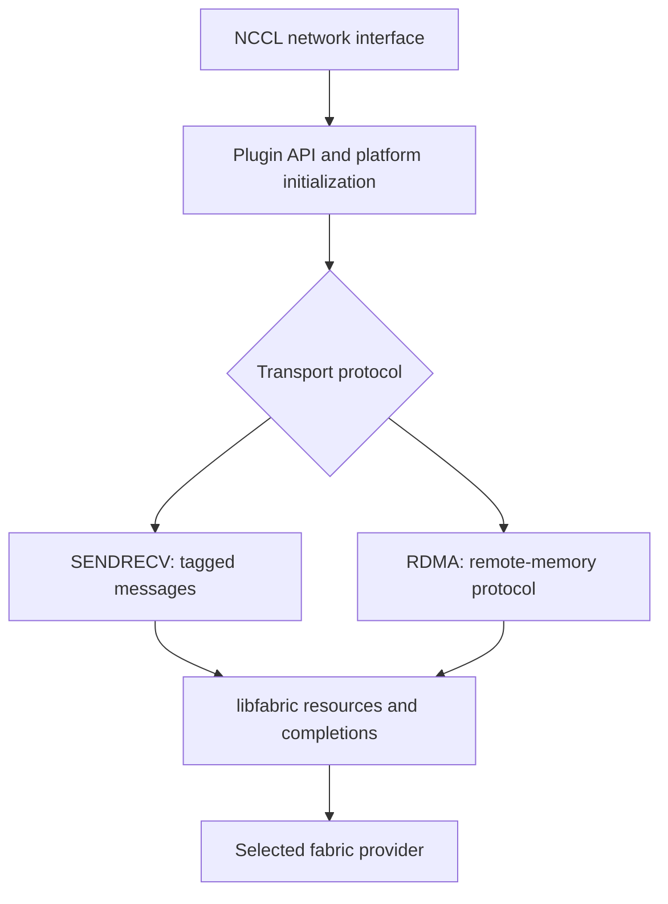

import SystemMap from '../../../components/SystemMap.astro';
import Source from '../../../components/Source.astro';

## Why it exists

A framework already using NCCL needs its network traffic to reach the cluster's
fabric. AWS OFI NCCL supplies that adapter: it implements NCCL's network callbacks
using **libfabric**, with EFA as an important supported provider. Developers can
use the available network without rewriting the model's collective operations.

The central translation is between NCCL's connection-like transport interface
and libfabric's reliable datagram endpoints, `FI_EP_RDM`. The plugin maintains
communicator and handshake state above those addressed endpoints.

## Where it fits

<SystemMap current="aws-ofi-nccl" />

NCCL chooses and decomposes collectives. The plugin moves the resulting network
messages. libfabric exposes fabric services, and its selected provider implements
the device-facing path. The framework continues to own tensors and model work.

This guide follows the NVIDIA NCCL interface. Loading the plugin, selecting a
transport and selecting an EFA provider are distinct startup outcomes.

## Architecture overview

**SENDRECV** uses tagged messages. **RDMA** exchanges control metadata and performs
remote-memory operations. They are alternative plugin implementations beneath
NCCL, with different request/progress machinery.

The plugin owns transport requests and registration bookkeeping. Its
**completion queues (CQs)** connect fabric events to those requests. Application
buffers must remain valid while accepted operations use them.

## Follow an operation

For an ordinary SENDRECV transfer:

1. NCCL loads a compatible callback table and initializes the plugin.
2. Startup applies platform policy, discovers provider capabilities and selects
   a transport. Connection callbacks exchange handles and establish communicators.
3. The caller registers participating memory as required by the selected path.
4. The plugin submits tagged send/receive work and returns accepted request state.
   Temporary backpressure can instead leave no request and require a retry.
5. Testing drives progress, observes completion and retires request bookkeeping.
   Required GPU visibility and CUDA stream dependencies complete the handoff to
   the consumer.

The [SENDRECV chapter](/architecture/aws-ofi-nccl/sendrecv-protocol/) is a useful
first source trace. Continue into [RDMA](/architecture/aws-ofi-nccl/rdma-protocol/)
for destination advertisement, remote writes and segmented completion.

## Decision gates

| Choice | Effect on the path |
| --- | --- |
| Loaded interface and library stack | Establish the callback contract and available implementation. |
| SENDRECV or RDMA | Choose tagged messaging or the remote-memory protocol. |
| Provider and memory support | Determine available devices, registration and GPU access. |
| Progress and visibility | Determine when accepted work advances and data can be consumed. |

Requested settings must be checked against returned capabilities. The
[selection chapter](/architecture/aws-ofi-nccl/provider-and-protocol/) identifies
which layer owns each choice.

## Explore the code

Read interface adaptation, shared dispatch, then the selected transport:

<Source project="aws-ofi-nccl" path="src/nccl_ofi_interface_nvidia.cpp" label="NCCL callback tables" />
<Source project="aws-ofi-nccl" path="src/nccl_ofi_api.cpp" label="Common API and communicator dispatch" />
<Source project="aws-ofi-nccl" path="src/nccl_ofi_net.cpp" label="Transport construction and selection" />
<Source project="aws-ofi-nccl" path="src/nccl_ofi_sendrecv.cpp" label="Tagged-message implementation" />
<Source project="aws-ofi-nccl" path="src/nccl_ofi_rdma.cpp" label="RDMA implementation" />
