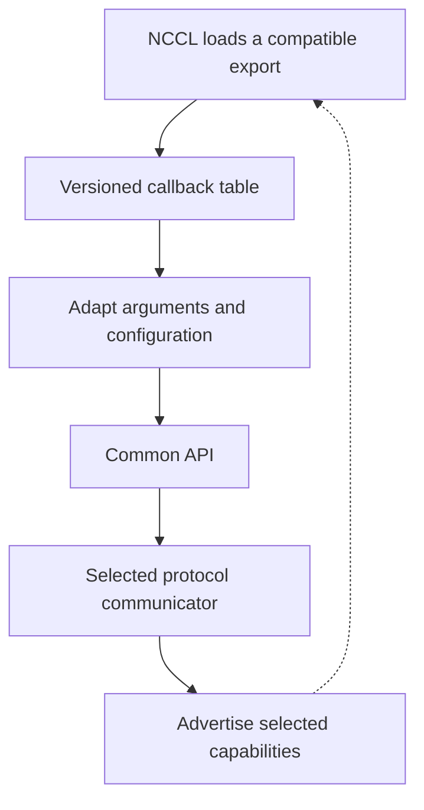

import Source from '../../../../components/Source.astro';

## The loaded callback table is the entrypoint

A network plugin is a shared library loaded by NCCL. The libraries must agree on
exported symbols, callback signatures and structure layouts: their **application
binary interface (ABI)**. AWS OFI NCCL exports versioned tables and adapts those
interfaces into one common implementation.

For a source trace, identify the interface NCCL actually loaded before following
its function pointers. Several wrapper names can lead to the same transport code.

## See the adaptation boundary

The wrapper performs interface adaptation. The transport determines how the
operation moves bytes and progresses; a new callback signature alone does not
add a new network mechanism.

## Follow one modern call

A modern initialization call can create configuration context used by later
connection calls. Its wrapper passes the relevant configuration into the common
API, which acquires the local endpoint and constructs transport state. Older
interfaces adapt their argument forms before reaching that same boundary.

Repeated interface initialization can share one internal plugin through wrapper
reference counting. Context lifetime and plugin lifetime therefore have different
scopes. Normal communicator, request and registration cleanup still follows their
own ownership rules.

Keep the selected interface version with runtime diagnostics. It explains which
wrapper ran, which configuration reached the common layer, and which lifecycle
callbacks the caller can use.

## Capabilities decide what the caller may use

The plugin reports device properties such as supported pointer types, registration
scope and receive capacity. Those properties come from the selected implementation
and validated memory path. They tell NCCL how to call the plugin correctly.

Some optional operations are unsupported by a particular interface or transport.
Begin with advertised support and the ordinary send/receive contract, then follow
an extension when the selected application actually uses it. This keeps interface
compatibility separate from provider capability and hardware readiness.

When upgrading libraries, the important architectural questions are:

- Did NCCL load the intended export and shared object?
- Do the selected callbacks and structures agree at the ABI boundary?
- Does the resulting transport advertise the operations and memory path needed?

Answer these before debugging packets. Loading success establishes the library
boundary, while initialization and a transfer establish later boundaries.

## Read the code

<Source project="aws-ofi-nccl" path="src/nccl_ofi_interface_nvidia.cpp" label="Export tables, wrappers and context lifetime" />
<Source project="aws-ofi-nccl" path="src/nccl_ofi_api.cpp" label="Common API and selected properties" />

Read one exported table and its send/connect wrappers, then continue into the
shared API. Consult the exact version-specific fields only when changing or
troubleshooting that interface.
