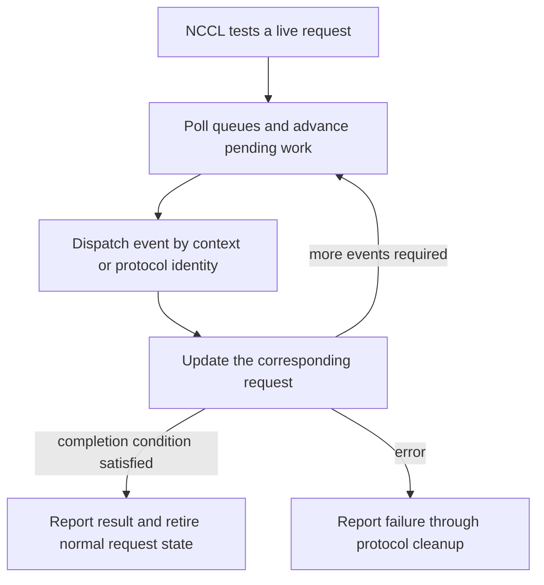

import Source from '../../../../components/Source.astro';

## Progress advances the operation as well as observing it

NCCL's test callback can cause real work: poll fabric completion queues, dispatch
context handlers, update requests and retry pending posts. Polling is therefore
part of the transport's execution path, rather than a passive query of one flag.

The selected protocol determines how fabric events combine into the logical
request NCCL is testing. A packet or segment completing can be an intermediate
step.

## Follow the return path

A progress call can advance several requests sharing endpoint resources. Reporting
one request done says nothing about the lifetime of unrelated outstanding work.

## Compare the two implementations

SENDRECV dispatches CQ operation contexts into handlers that update message
requests and handshake state. Terminal testing reports size/outcome and returns
the request entry to its pool.

RDMA progress visits rails, handles control/data contributions and services pending
requests. Its logical completion can depend on several segment events and protocol
state. Error retirement is also protocol-specific; a generic wrapper should not
assume every negative test result frees the same objects.

CQ return values identify different actions. An empty read means no event is
available now, while EAVAIL directs the code to retrieve a CQ error entry. Preserve
the request and provider diagnostics until the selected path resolves their
outcome. A posting retry and an empty completion read occur at different stages.

## Join communication completion with GPU readiness

The receive path can need a GPU visibility action after its payload operation.
The common flush callback dispatches to the selected receive communicator; the
chosen memory/path configuration determines the actual work. An asynchronous
flush request also needs progress and testing.

That visibility boundary is part of communication. NCCL and the framework connect
it to the stream dependency for the GPU consumer. They also retain allocation
lifetime through outstanding work.

When a transfer stalls, track accepted posting, observed fabric events, remaining
protocol contributions and required visibility separately. Busy polling can
change observation/progress cadence, but it cannot replace a missing peer receive
or repair invalid memory ownership.

## Read the code

<Source project="aws-ofi-nccl" path="src/nccl_ofi_sendrecv.cpp" label="Tagged CQ dispatch, request testing and flush" />
<Source project="aws-ofi-nccl" path="src/nccl_ofi_rdma.cpp" label="Multi-rail progress and pending requests" />
<Source project="aws-ofi-nccl" path="src/nccl_ofi_api.cpp" label="Common test and flush callback boundary" />
<Source project="aws-ofi-nccl" path="doc/tracing.md" label="Correlating callbacks, requests and fabric contexts" />
