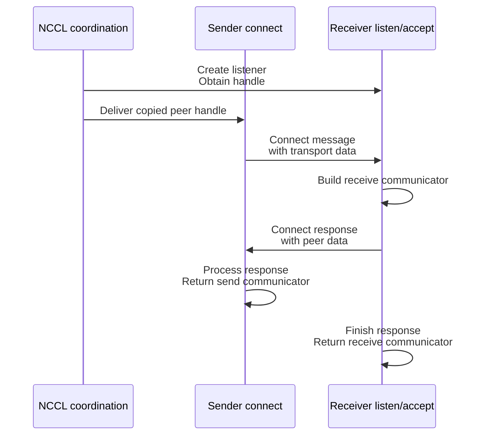

import Source from '../../../../components/Source.astro';

## Build a connection-like contract over datagram endpoints

NCCL asks the plugin to listen, connect and accept. libfabric's selected reliable
datagram interface communicates through addressed endpoints. The plugin bridges
those models with communicator state and a transport handshake.

Two exchanges matter: NCCL coordinates delivery of a listener handle, then the
plugin exchanges the transport information needed for an actual communicator.

## Follow the handle and handshake

The listener handle is copied connection information. It is not a remotely usable
pointer to the listener's process objects. Its delivery lets the sender begin
plugin-level connection work.

Each participant progresses its own handshake. Repeated connect/accept calls can
leave the output communicator absent while setup remains pending. A usable
communicator appears only after that side's required state is ready.

## Keep local resources and peer metadata separate

The common API obtains a local endpoint from the selected device/domain resource
organization. The resulting send or receive communicator retains an endpoint
reference, preserving the local resources it needs.

The connection manager owns request/response work and transport payload exchange.
SENDRECV learns the peer endpoint and communicator tag used for payload matching.
RDMA additionally exchanges rail information and control-mailbox access needed by
its remote-memory protocol.

An established connection therefore supplies persistent peer/protocol identity.
Individual receive buffers and memory authorization still arrive through later
registration and operation calls. Connection setup does not preallocate every
future tensor destination.

## Choices that change setup or lifetime

**Transport:** SENDRECV and RDMA attach different metadata and readiness conditions
to the shared connection machinery. Follow the selected communicator implementation
rather than assuming one generic handshake contains every optional field.

**Resource sharing:** a listener can serve several communicator cycles. Established
communicators retain their own resource references, so closing the listener and
retiring active payload communicators are distinct lifecycle actions.

**Shutdown:** the caller must stop issuing new work before retiring communicators.
Accepted operations and protocol cleanup can still hold state; an interrupted
close does not establish successful delivery of those payloads.

When setup stalls, record which exchange completed: handle delivery, connect
request, response or returned communicator. This locates the owner before payload
progress is involved. Include the selected transport and local endpoint identity
when comparing both peers.

## Read the code

<Source project="aws-ofi-nccl" path="src/nccl_ofi_api.cpp" label="Common listen/connect/accept dispatch" />
<Source project="aws-ofi-nccl" path="include/cm/nccl_ofi_cm.h" label="Connection-manager ownership and readiness" />
<Source project="aws-ofi-nccl" path="src/nccl_ofi_sendrecv.cpp" label="SENDRECV handshake and communicator construction" />
<Source project="aws-ofi-nccl" path="src/nccl_ofi_rdma.cpp" label="RDMA rail and mailbox exchange" />
