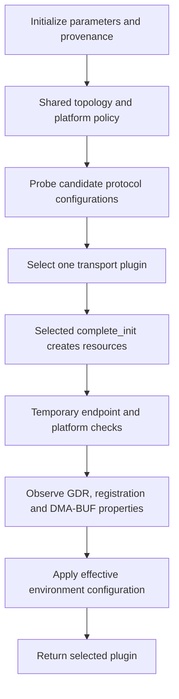

import Source from '../../../../components/Source.astro';

## Startup turns a library into a usable transport

A loaded plugin still needs valid parameters, platform policy, matching provider
capabilities and initialized resources. Startup joins those inputs and publishes
the properties NCCL will rely on for subsequent connections and transfers.

The versioned wrapper manages its interface context. Common initialization creates
the internal plugin and selected transport. Follow those scopes separately when
tracing repeated initialization or shutdown.

## Follow the construction spine

Initialization proceeds through intermediate successes: a candidate can be
successfully discovered before its resources and endpoint capabilities are fully
validated. Only the selected, completed path becomes the usable plugin.

Parameters include both values and their source: environment overrides,
API/platform settings or defaults. Recording that provenance explains why a choice
was made and which layer can change it.

## Discover first, then complete the selected candidate

`nccl_net_ofi_create_plugin` creates shared topology/platform context and applies
platform policy. It probes transport candidates using libfabric information, then
chooses one according to configuration and discovery results.

The chosen plugin's `complete_init` creates its devices and network resources.
Endpoint setup and platform checks establish later properties, including the
usable GPU memory path. Capability discovery and concrete endpoint validation
are both part of startup.

The split avoids treating all successfully probed alternatives as active payload
transports. A communicator subsequently uses the implementation selected during
this process.

## Decisions that change the path

**Configuration:** an explicit transport request chooses that initializer and can
fail when its requirements cannot be satisfied. Default selection follows the
implemented platform/topology policy; the [selection chapter](/architecture/aws-ofi-nccl/provider-and-protocol/)
shows its effect.

**Provider and memory support:** returned fabric capabilities and endpoint checks
determine which operations and buffer types can be advertised. Device-memory
support, direct access and DMA-BUF registration are related but distinct facts.

**Resource scope:** the plugin exposes devices, domains and endpoints shared by
communicators. Requests retain narrower operation state. Cleanup must account for
which owners were successfully created and which still have users.

For a startup incident, record the last completed stage, effective settings,
selected provider/transport and endpoint-check result. This distinguishes a
configuration or discovery failure from later connection and payload work.

## Read the code

<Source project="aws-ofi-nccl" path="src/nccl_ofi_api.cpp" label="Common initialization and finalization" />
<Source project="aws-ofi-nccl" path="src/nccl_ofi_net.cpp" label="Platform setup, candidate selection and complete_init" />
<Source project="aws-ofi-nccl" path="include/nccl_ofi.h" label="Resource construction contracts" />
<Source project="aws-ofi-nccl" path="src/nccl_ofi_param.cpp" label="Parameter initialization" />

Read common init → plugin creation → selected initializer → `complete_init` →
endpoint/property checks. Enter individual option definitions when they explain
an observed selection rather than reading the whole configuration catalog first.
