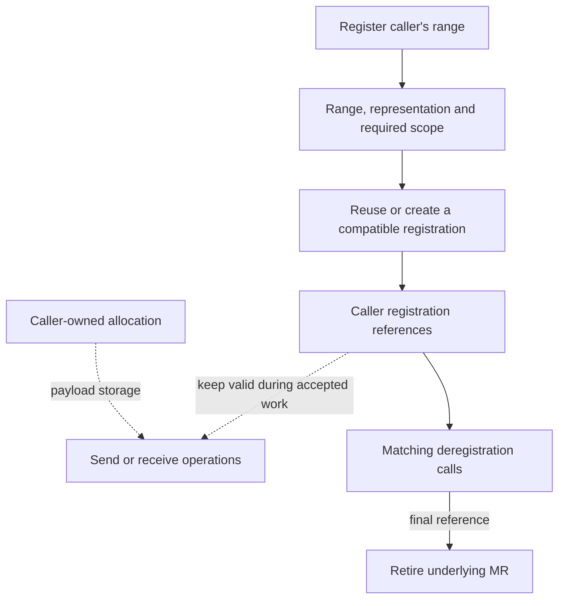

import Source from '../../../../components/Source.astro';

## Registration authorizes access to caller-owned storage

NCCL supplies host or device buffers. The plugin registers the ranges required by
the selected provider and returns a memory handle used by operations. Registration
creates transport access state; the framework still owns the tensor allocation.

A registration cache amortizes repeated setup for communication pools. Its key
questions are whether an existing registration covers the range and required
scope, and how many registration references still use it.

## See the ownership boundary

Request completion and registration-reference accounting are separate. The caller
must retire active uses before withdrawing their memory access or recycling the
allocation.

## Follow registration through the cache

The common API forms a key describing the range and memory representation. The
cache looks for covering registration and checks endpoint scope when the provider
requires endpoint-bound MRs. A hit acquires another reference; a miss creates and
inserts provider access state.

Registration coverage can be larger than the requested payload. The operation
still transfers its requested address and length. A covering cache entry also
does not establish that freed or remapped storage at the same virtual address is
the same valid application allocation.

SENDRECV protects cache lookup, creation and insertion with its registration
bookkeeping lock. This serializes cache state; GPU producer readiness is supplied
by the surrounding execution/stream contract.

## Memory and scope choices matter

**Registration scope:** returned provider modes can bind a registration to an
endpoint. A covering range then needs compatible endpoint identity before reuse.
The selected properties describe whether registration can be shared more broadly.

**Device memory:** GPU buffers require the supported memory interface, access
permissions and concrete device path. DMA-BUF is one supported registration
representation, subject to build, driver and provider capability. It is distinct
from simply passing a device pointer.

**Release:** deregistration drops a reference. Remaining users keep the shared MR
live; the last release retires it. Allocation changes and outstanding transfers
still require caller coordination, independently of cache reference counts.

These are the important pool-design decisions. Exact granule rounding and
platform-specific registration attributes are useful follow-up source details.

## Read the code

<Source project="aws-ofi-nccl" path="src/nccl_ofi_api.cpp" label="Registration API and key construction" />
<Source project="aws-ofi-nccl" path="src/nccl_ofi_mr.cpp" label="Coverage, scope and cache references" />
<Source project="aws-ofi-nccl" path="src/nccl_ofi_sendrecv.cpp" label="SENDRECV provider registration and release" />
<Source project="aws-ofi-nccl" path="src/nccl_ofi_dmabuf.cpp" label="DMA-BUF capability path" />
