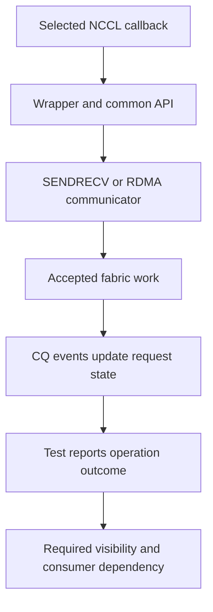

import Source from '../../../../components/Source.astro';

## Trace one operation before diagnosing the fabric

A failed collective can originate in the framework, NCCL, the plugin or its
selected provider. Follow one callback through its owners and identify the last
successful handoff. That is a more useful starting point than assigning every
failure to the network.

Use an ordinary established SENDRECV transfer as the first trace. The RDMA chapters
then add control metadata, rail schedules and aggregated completion under the same
callback boundary.

## Follow the implementation spine

A retry before acceptance has no completed payload to retire. After acceptance,
retain the buffer, registration and request state until the selected lifecycle
permits release.

## Attach evidence to each boundary

| Boundary | Evidence to preserve |
| --- | --- |
| Load and startup | Actual libraries, interface, effective settings and selected provider/transport |
| Connection and registration | Peer/communicator identity and valid memory scope |
| Posting and progress | Acceptance, request/context identity and remaining work |
| Completion and consumption | Outcome, required visibility and consumer ordering |

Pooled addresses can recur. Include communicator, operation order and relevant
protocol identity when correlating logs so a later request is not mistaken for
an earlier object at the same address.

An unexpected transport choice points to parameter provenance and the current
selection branch. Repeated posting retries point to admission, resources and
progress. Accepted work that stalls points to peer matching, protocol events or
visibility. These distinctions choose the next source trace without cataloging
every implementation option.

## Shutdown is another ownership transition

Orderly shutdown settles accepted work and required visibility before resource
retirement. Interrupted-close paths withdraw public use and release or invalidate
transport resources; they do not certify delivery or undo bytes already written.

RDMA can mark a communicator inactive while retaining internal deferred cleanup
for close/control conditions. A returned close call therefore need not mean every
internal object has already been destroyed. The plugin must keep referenced state
valid until that cleanup retires it, and the caller must honor its payload lifetime
contract.

## Read the code in operation order

<Source project="aws-ofi-nccl" path="src/nccl_ofi_interface_nvidia.cpp" label="Exported callback to wrapper" />
<Source project="aws-ofi-nccl" path="src/nccl_ofi_api.cpp" label="Common dispatch" />
<Source project="aws-ofi-nccl" path="src/nccl_ofi_sendrecv.cpp" label="Tagged posting, test and close" />
<Source project="aws-ofi-nccl" path="src/nccl_ofi_rdma.cpp" label="RDMA progress and deferred cleanup" />
<Source project="aws-ofi-nccl" path="doc/tracing.md" label="Cross-layer trace identities" />

Once the owner is located, the linked implementation and its focused tests supply
the deeper evidence for that boundary.
