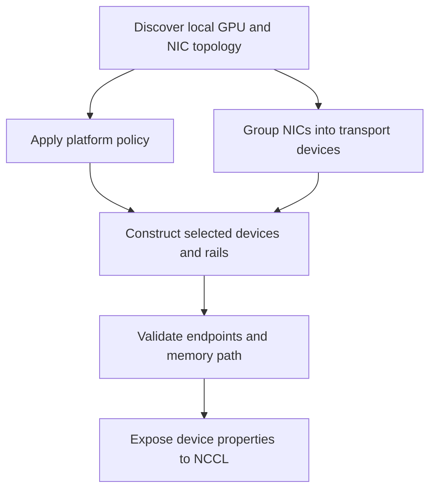

import Source from '../../../../components/Source.astro';

## Turn local hardware into a transport view

A process sees GPUs, NICs and their host interconnect relationships. The plugin
uses platform policy and topology to decide which transport devices and rails it
can expose. Those choices affect registration, locality and the paths available
for a transfer.

This is local resource organization. NCCL separately constructs the job's
collective communication graph across ranks.

## Follow policy into usable devices

The graph shows successive owners and checks. A policy preference becomes a
usable path only after discovery and endpoint validation succeed.

## Platform policy and discovered capability

Platform selection runs before final transport construction. AWS-specific policy
can recognize the environment and supply suitable defaults or provider preference.
Explicit configuration and the source of a parameter matter when interpreting
those choices.

Provider discovery still has to find compatible resources. Endpoint checks then
establish properties that cannot be inferred from a platform name alone, including
the usable GPU-memory path. Log policy, selected provider and checked properties
as separate stages of the startup trace.

## What topology grouping changes

The transport can represent a group of NIC paths as one device with multiple
rails. A **rail** is one path in that device's transfer organization. Grouping
therefore changes the resource view available to the protocol and its byte
scheduler.

PCIe and host topology also help interpret GPU/NIC locality. Sharing a switch is
a narrower relationship than sharing a host bridge; topology code uses concrete
relationships rather than a single label saying all local devices are equally
near. The resulting grouping still does not guarantee proportional bandwidth for
an arbitrary workload.

Once devices are exposed, the framework's rank placement and NCCL's collective
graph add another level of choice. Keep that job-level organization separate from
one process's NIC grouping when diagnosing why traffic takes a particular path.

## Decisions and code route

Start with three questions: which platform policy ran, which NICs formed the
selected device, and which endpoint/memory properties were validated? Then enter
[rail scheduling](/architecture/aws-ofi-nccl/rails-and-scheduling/) to see how one
message is divided over that device.

<Source project="aws-ofi-nccl" path="src/nccl_ofi_platform.cpp" label="Platform selection" />
<Source project="aws-ofi-nccl" path="src/platform-aws.cpp" label="AWS platform policy and capability checks" />
<Source project="aws-ofi-nccl" path="src/nccl_ofi_topo.cpp" label="Local topology and device grouping" />
<Source project="aws-ofi-nccl" path="doc/topology-aware.md" label="Topology-aware deployment context" />
