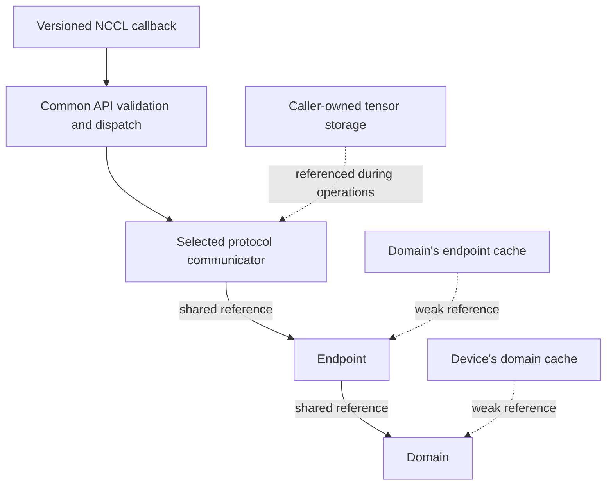

import Source from '../../../../components/Source.astro';

## Adapt a network interface rather than a collective algorithm

AWS OFI NCCL implements the network operations NCCL needs after decomposing a
collective: discover devices, connect peers, register memory, submit messages and
test completion. The collective algorithm and its GPU work remain in NCCL.

Below the adapter, libfabric supplies provider discovery, endpoints, memory
registration and completion queues. The plugin bridges these resource models and
retains enough state to present NCCL's connection-like, asynchronous API.

## Follow the callback into its owner

Versioned interface wrappers adapt calls into the common API. The common layer
validates arguments and dispatches through the selected protocol's objects.
Communicators retain endpoints; endpoints retain domains. Their caches use weak
references, so a cache entry alone does not keep the underlying object alive.

Tensor storage stays with the caller. A registration describes access to that
storage, while a request records one operation using it. Keeping these separate
explains both normal completion and shutdown.

## Trace one send through the layers

A send callback supplies the communicator, payload range and memory handle. The
common API reaches that communicator's SENDRECV or RDMA method. The method obtains
request state and posts fabric work, or arranges a retry when it cannot yet
accept the operation.

Accepted work returns a request that NCCL later tests. Fabric CQ events update
its state, and the selected transport aggregates the events needed for logical
completion. Terminal testing can retire pooled request storage, so the pointer
is temporary identity rather than a durable application object.

Receive completion can also need the selected GPU visibility action before NCCL
publishes data to GPU consumption. The framework's stream ordering connects that
communication boundary to subsequent computation.

## The consequential boundaries

| Boundary | What the developer should trace |
| --- | --- |
| NCCL to wrapper | Which callback interface was loaded? |
| Common API to transport | Which communicator implementation owns the operation? |
| Transport to libfabric | Was work accepted, and what resources must remain live? |
| Completion to consumer | Which request/visibility conditions let NCCL advance? |

Properties advertise the selected device and memory support. Inspect them rather
than inferring a capability from the existence of an API callback. An available
interface, a usable provider path and accepted work are successive requirements.

A successful callback with no request can represent retryable lack of acceptance.
A live request represents outstanding transport state. These are different states
in NCCL's nonblocking contract and should stay distinct in logs and wrappers.

## Read the code

Start at the exported table, enter shared dispatch, then follow the object methods
into the chosen transport:

<Source project="aws-ofi-nccl" path="src/nccl_ofi_interface_nvidia.cpp" label="NVIDIA callback exports" />
<Source project="aws-ofi-nccl" path="src/nccl_ofi_api.cpp" label="Common API validation and dispatch" />
<Source project="aws-ofi-nccl" path="include/nccl_ofi.h" label="Plugin, domain, endpoint and communicator contracts" />
