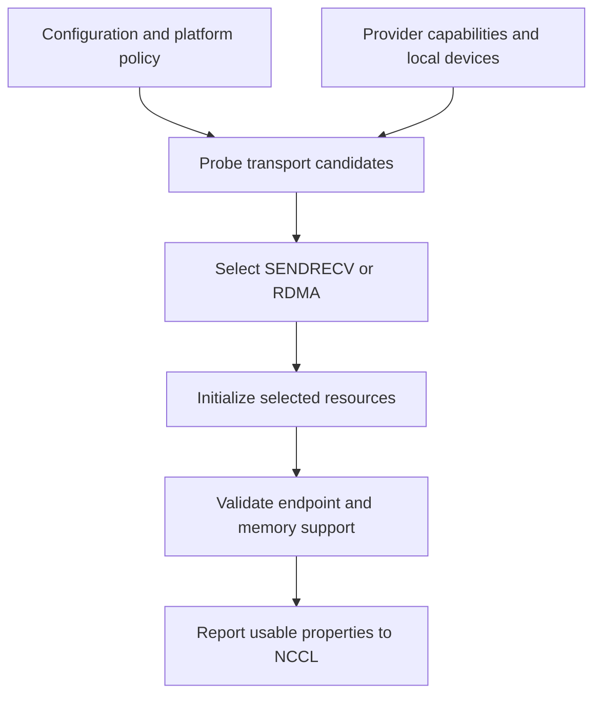

import Source from '../../../../components/Source.astro';

## Separate three layers of selection

A deployment can report RDMA, EFA and SIMPLE at the same time. They describe
separate choices: **RDMA** is a plugin transport, **EFA** is a libfabric provider
path, and **SIMPLE** is an NCCL communication protocol above the plugin.

Keep those owners visible. NCCL chooses collective behavior, the plugin chooses
its transport implementation, and libfabric returns configurations implementing
the required fabric services.

## Join policy with available capabilities

A requested setting expresses intent. The returned capabilities and completed
checks establish what the implementation can actually offer.

## Follow the current selection policy

An explicit SENDRECV or RDMA request enters that initializer directly. Failure
of the requested path is reported rather than automatically changing the request
into another transport.

For default provenance, this pinned implementation prefers a usable multi-rail
RDMA candidate. Otherwise it selects SENDRECV and discards the remaining RDMA
candidate. It does not retain single-rail RDMA as a final fallback after an
unavailable SENDRECV candidate. Read the executable selection branch when
explaining runtime behavior.

After selection, resource completion and endpoint checks still run. Winning
candidate selection is an intermediate startup result.

## What the provider query establishes

The protocol initializer supplies `fi_getinfo` hints describing required endpoint,
operation, memory and progress services. Filtering then narrows the returned
provider/fabric configuration and local NIC entries.

SENDRECV needs tagged messaging. RDMA needs remote-memory operations and the
completion/control facilities used by its protocol. Returned memory-registration
modes determine addressing and registration scope; returned progress properties
influence how outstanding work advances.

GPU memory adds another negotiation boundary. Heterogeneous-memory support alone
is insufficient to establish every direct-access or DMA-BUF route. The selected
endpoint and platform checks provide the concrete capability reported to NCCL.

When selection fails, preserve the original requested settings and returned
information. Relaxing a requirement is an application/operator decision about the
service needed, rather than a generic way to make initialization succeed.

## Read the code

<Source project="aws-ofi-nccl" path="src/nccl_ofi_net.cpp" label="Actual transport selection and candidate ownership" />
<Source project="aws-ofi-nccl" path="src/nccl_ofi_ofiutils.cpp" label="Provider queries, filtering and returned modes" />
<Source project="aws-ofi-nccl" path="src/nccl_ofi_sendrecv.cpp" label="SENDRECV service requirements" />
<Source project="aws-ofi-nccl" path="src/nccl_ofi_rdma.cpp" label="RDMA service requirements" />
