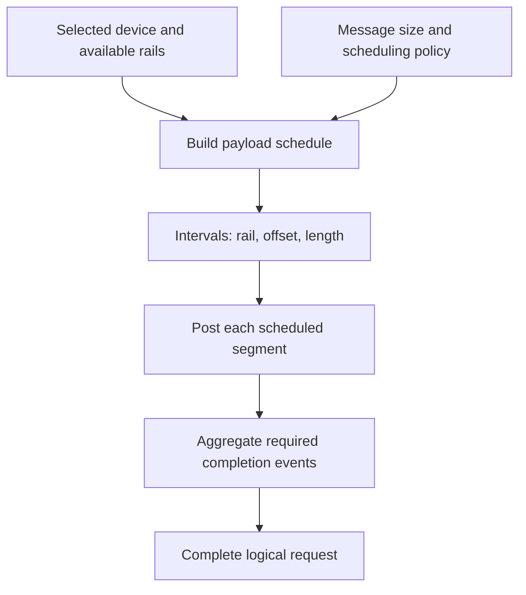

import Source from '../../../../components/Source.astro';

## Map one logical payload onto available paths

A multi-rail device offers several transport paths. The RDMA scheduler chooses
which byte intervals each rail carries. This is a byte-mapping decision beneath
NCCL's collective algorithm, distinct from the inference engine's token scheduler.

A **rail** belongs to the selected transport device's organization. Multiple rails
can use several NIC paths; their existence alone does not guarantee equal work or
proportional bandwidth on every message.

## Follow the scheduling contract

The schedule specifies byte coverage, not extra application payload. Offsets and
lengths connect the same logical range to local source and advertised remote
destination coordinates.

## Small-message selection and larger-message striping

The threshold scheduler treats small messages as one transfer on a rotating rail.
For larger messages it chooses a stripe count and aligned segment sizes under the
available rail organization. Exact divisor/alignment calculations implement that
policy; the architectural result is a list of transfer intervals.

Control messages have their own rail organization and can share completion
resources with data endpoints. Keep control movement and payload striping
separate when interpreting counters or a trace.

Topology supplies the candidate paths, while scheduling chooses their use for a
particular payload. Changing NIC grouping therefore changes what the scheduler
can choose without changing the callback's logical message interface.

## Preserve the mapping through retries and completion

A request retains its schedule while work is active. Successful segment posts
advance its cursor; retryable pressure resumes remaining work rather than
reposting every earlier interval. The schedule storage remains live until the
request no longer needs it.

Completion then accounts for all required segment and control contributions.
One segment finishing proves progress on that portion, while the logical request
can still be outstanding.

For diagnosis, check that the intervals cover the intended payload and use the
expected local/remote offsets. Then compare accepted posts and completions with
those intervals. This locates a mapping or progress problem before interpreting
uneven rail counters as a bandwidth issue.

## Read the code

<Source project="aws-ofi-nccl" path="include/nccl_ofi_scheduler.h" label="Schedule and transfer interval structures" />
<Source project="aws-ofi-nccl" path="src/nccl_ofi_scheduler.cpp" label="Threshold policy and stripe construction" />
<Source project="aws-ofi-nccl" path="src/nccl_ofi_rdma.cpp" label="Device rails, segment posting and retry cursor" />

Read the schedule fields first, then its policy and the request's posting loop.
Inspect exact threshold math when explaining a specific measured mapping, after
the ownership and byte-coverage contract is clear.
