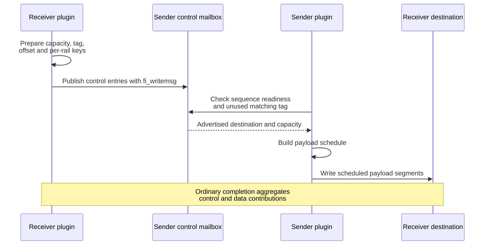

import Source from '../../../../components/Source.astro';

## Remote writes still need a destination protocol

NCCL's send callback supplies a local payload, not the peer's current receive
address and key. The RDMA transport first exchanges control information so the
sender can target a valid registered destination. It then maps the logical
message onto remote-memory operations and aggregates their completion.

This chapter follows ordinary rendezvous. Small eager messages and specialized
completion contracts are alternatives to that baseline.

## Follow destination advertisement into payload movement

Connection setup establishes peer identity, rail endpoints and control-mailbox
access. A later receive advertises its actual buffer range, capacity, matching
identity and registration keys into that mailbox. The destination remains
caller-owned throughout.

The sender checks usable control information, chooses the matching receive and
builds a payload schedule. Without a usable advertised destination, an ordinary
rendezvous send can return no public request and wait for another attempt.

A ready control entry authorizes the next transfer step; it is not evidence that
the payload has already arrived.

## A logical message can own several fabric operations

The schedule divides the payload into rail segments. Each post uses the local
and remote range for that segment plus the selected rail's memory access data.
Retry state preserves already accepted segments so later attempts resume pending
work instead of duplicating completed posts.

The receiver tracks the corresponding segment and control contributions under
its parent request. The sender similarly accounts for local segment completion.
One CQ event can therefore advance part of a logical request without completing
the request NCCL is testing.

This parent/child ownership explains why mailbox state, segment entries and the
public request must remain live for their respective protocol events. The
[resource chapter](/architecture/aws-ofi-nccl/request-resources/) connects those
objects to their pools and release paths.

## Choices that change the protocol

**Rendezvous or eager:** rendezvous waits for destination advertisement. An enabled
eager path can stage eligible small data before its final receive is available,
then match and copy it into the actual destination. It adds buffering and
matching state rather than simply removing control work.

**Ordinary or delegated validation:** a specialized early-completion path relies
on NCCL's supported flag-based arrival validation and negotiated constraints.
That contract should not be interpreted as ordinary completion of every target
write. Use the selected path's actual completion conditions.

**One or several rails:** rail scheduling changes segmentation and the set of
required events. Completion must aggregate the whole logical operation, while
caller memory remains valid until its contract permits reuse.

## Read the code

<Source project="aws-ofi-nccl" path="include/nccl_ofi_rdma.h" label="Communicator, mailbox and request relationships" />
<Source project="aws-ofi-nccl" path="src/nccl_ofi_rdma.cpp" label="Control publication, matching, segment posting and completion" />

Read connection data → receive/control preparation → `has_ctrl_msg` → send
schedule/post → CQ aggregation → parent request test and release. Enter eager or
early-completion internals when that selected mode explains the observed path.
