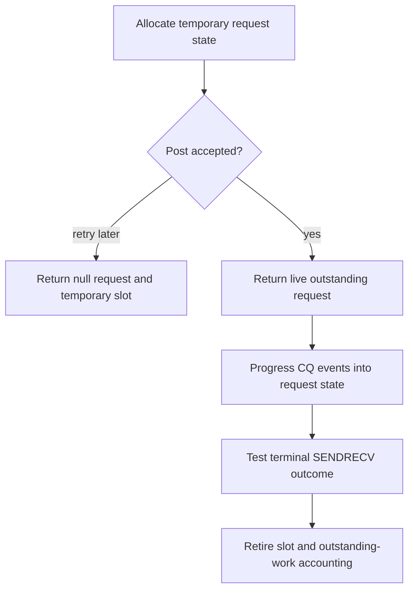

import Source from '../../../../components/Source.astro';

## A request is retained transport state

A nonblocking network operation needs state after its submit call returns. AWS
OFI NCCL uses request objects to connect communicator, payload, fabric contexts and
completion accounting. NCCL later tests the returned request to advance or retire
that work.

Requests often come from a **freelist**, a pool whose entries can be reused. The
returned pointer identifies a live operation only for its valid lifetime; later
work can occupy the same address.

## Follow acceptance before counting outstanding work

The diagram is scoped to SENDRECV. It separates a submit attempt from an accepted
operation without making the temporary pool slot part of the caller's public
state.

## Three lifetimes surround the pointer

**Backing storage:** a freelist can allocate larger blocks containing many request
entries. Some transport pools use registered backing memory. The block and an
individual active entry have different reuse/release boundaries.

**Logical request:** initialization resets an entry for one operation. Its context
can be returned asynchronously by the provider, so the entry remains valid until
the selected request lifecycle retires it.

**Payload and registration:** the framework owns the tensor. Its valid allocation
and memory access information must outlive accepted operations using them. Pooling
request bookkeeping does not take ownership of the tensor's allocation.

These scopes explain why request release, deregistration and buffer reuse should
not be collapsed into one generic free operation.

## Protocol choices affect retained state

SENDRECV can report successful callback handling with a null request when posting
was not accepted and the caller should retry. RDMA can instead retain pending
work internally and resume segment posting later. Read acceptance and retry
ownership in the selected protocol.

RDMA also uses typed parent/child requests for control, data segments and other
protocol work. One logical operation can therefore own several internal entries
and complete after several events. Identifier pools and inflight limits bound
how much such state can remain live.

For diagnosis, retain communicator and operation order alongside a request
address. Copy needed observations before terminal testing can return the slot
to the pool. Error cleanup follows the protocol's lifecycle rather than an
assumption that every test result releases state identically.

## Read the code

<Source project="aws-ofi-nccl" path="include/nccl_ofi_freelist.h" label="Freelist entry and backing-block ownership" />
<Source project="aws-ofi-nccl" path="src/nccl_ofi_freelist.cpp" label="Pool allocation and release" />
<Source project="aws-ofi-nccl" path="src/nccl_ofi_sendrecv.cpp" label="Request allocation, acceptance and test/free" />
<Source project="aws-ofi-nccl" path="include/nccl_ofi_rdma.h" label="RDMA typed request relationships" />
