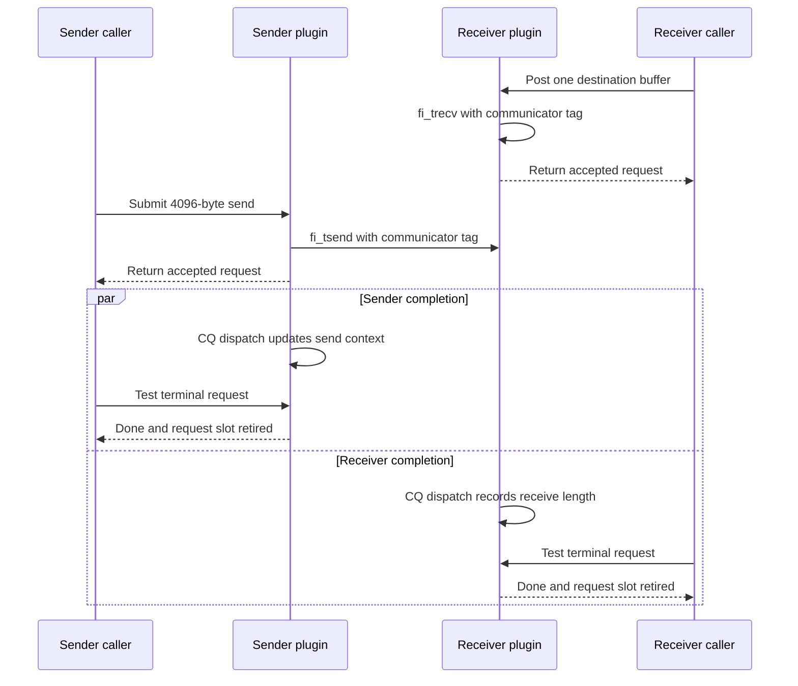

import Source from '../../../../components/Source.astro';

## Pair tagged messages through an established communicator

SENDRECV implements NCCL's network transfer callbacks with libfabric tagged send
and receive operations. It is the simplest payload trace: an established
communicator supplies peer/matching identity, registered buffers supply access,
and request contexts connect fabric outcomes to NCCL's test callback.

The communicator's negotiated tag is used for fabric matching in this
implementation. It is not simply the arbitrary tag argument from each NCCL
callback. The selected SENDRECV properties also bound its receive interface.

## Follow one ordinary transfer



The diagram uses a 4096-byte example and accepted posts. Sender and receiver
observe their own request completions independently. The middle transfer arrow
abstracts libfabric and the selected provider.

The sender allocates a request, captures communicator and payload information,
obtains a memory descriptor, and posts:

```cpp
rc = fi_tsend(this->local_ep, data, size, desc,
              this->remote_ep, this->tag, sendrecv_req_get_ofi_context(req));
```

The receiver prepares a destination and posts `fi_trecv` with the established
communicator tag. Both retain valid buffers, registration and request context
while the provider can access them.

## Separate retry from accepted work

A fabric post can temporarily return EAGAIN before acceptance. SENDRECV progresses
completions, returns its temporary request entry to the pool, and leaves the
public request null. NCCL can retry; it must not test that unexposed temporary
entry or interpret callback success alone as completed payload movement.

Accepted posting returns a live request and increments outstanding accounting.
CQ context handlers later mark completion or error. Terminal SENDRECV testing
reports the corresponding outcome and retires that request entry. Its address
can then be reused by a later operation.

## Complete the handoff to GPU consumption

CQ processing handles the fabric/protocol outcome. The selected receive path can
also require a GPU visibility flush, and that flush can itself have asynchronous
work. NCCL and the framework supply the stream dependency to the subsequent
consumer.

These are successive boundaries: submission acceptance, request completion,
required visibility and consumer execution. Keeping them distinct makes both
buffer lifetime and stalls understandable without enumerating every flush option.

For a stalled transfer, first check that the intended receive and peer identity
exist, then inspect post acceptance and CQ progress. A saturated request pool or
unadvanced completion path can cause retries before link bandwidth is the limit.

## Read the code

<Source project="aws-ofi-nccl" path="src/nccl_ofi_sendrecv.cpp" label="Communicator matching, send/receive, context dispatch, test and flush" />

Read communicator construction → `send`/`recv` → `sendrecv_process_completions` →
context handlers → request `test`. Continue into the common
<Source project="aws-ofi-nccl" path="src/nccl_ofi_api.cpp" label="Callback dispatch and receive flush" />
when tracing the surrounding NCCL interface.
