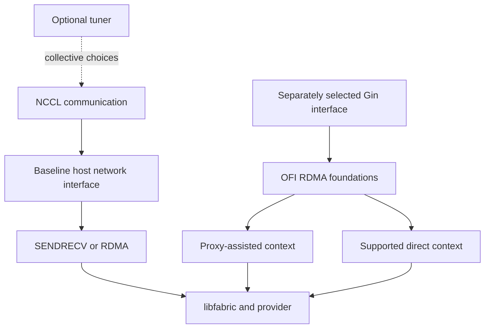

import Source from '../../../../components/Source.astro';

## Optional interfaces change different parts of communication

The baseline network plugin answers how NCCL's host-side transport work reaches
libfabric. The optional **tuner** influences collective choices above that path.
**Gin** exposes GPU-initiated networking interfaces with separately selected
execution owners.

These extensions share foundations without becoming required stages of an
ordinary SENDRECV or RDMA message. Understand the baseline transport first, then
follow the extension used by the deployment.

## Place each interface at its boundary

The Gin branches represent selected interface/context paths, not an automatic
attempt of direct access followed by proxy fallback.

## The tuner influences collective planning

Tuner callbacks receive collective/workload information and can influence NCCL's
algorithm, protocol or channel choices. That affects how communication work is
planned rather than implementing the payload transfer itself.

An unavailable or inactive tuning context can leave NCCL's own tuning in control.
Distinguish that supported fallback from network initialization failure. Record
which tuner was actually loaded when explaining a collective choice.

## Gin changes who initiates and progresses work

Gin requires the initialized OFI RDMA foundation and its own supported capability
contract. Proxy-assisted execution has CPU-side progress, while the supported
EFA/GDAKI direct path constructs device-visible resources for GPU-side use.

The selected interface table and context determine the path. Direct resources
also have capability and layout requirements, because a consumer must interpret
its device-visible structures correctly. Those checks belong at context creation;
they are not evidence that every ordinary RDMA message executes from a GPU kernel.

Registration, windows and context resources keep their own lifetimes. GPU-initiated
submission still needs valid memory and synchronization through the relevant
completion/consumer contract.

## Decide whether to enter an extension

Start with the engineering question. To explain a collective algorithm choice,
follow the tuner above the network transport. To explain GPU-originated networking,
follow the bound Gin interface and its context. To explain an ordinary callback
transfer, stay on the baseline network path.

This keeps optional capabilities out of the main payload trace while making their
source entrypoints available when the deployment uses them.

## Read the code

<Source project="aws-ofi-nccl" path="src/tuner/nccl_ofi_tuner.cpp" label="Tuner initialization and callback delegation" />
<Source project="aws-ofi-nccl" path="src/rdma/gin/nccl_ofi_gin_api.cpp" label="Shared Gin prerequisites and interface exports" />
<Source project="aws-ofi-nccl" path="src/rdma/gin/nccl_ofi_gin_gdaki.cpp" label="Direct context resources and validation" />
<Source project="aws-ofi-nccl" path="doc/gin-getting-started.md" label="Gin deployment and use context" />
