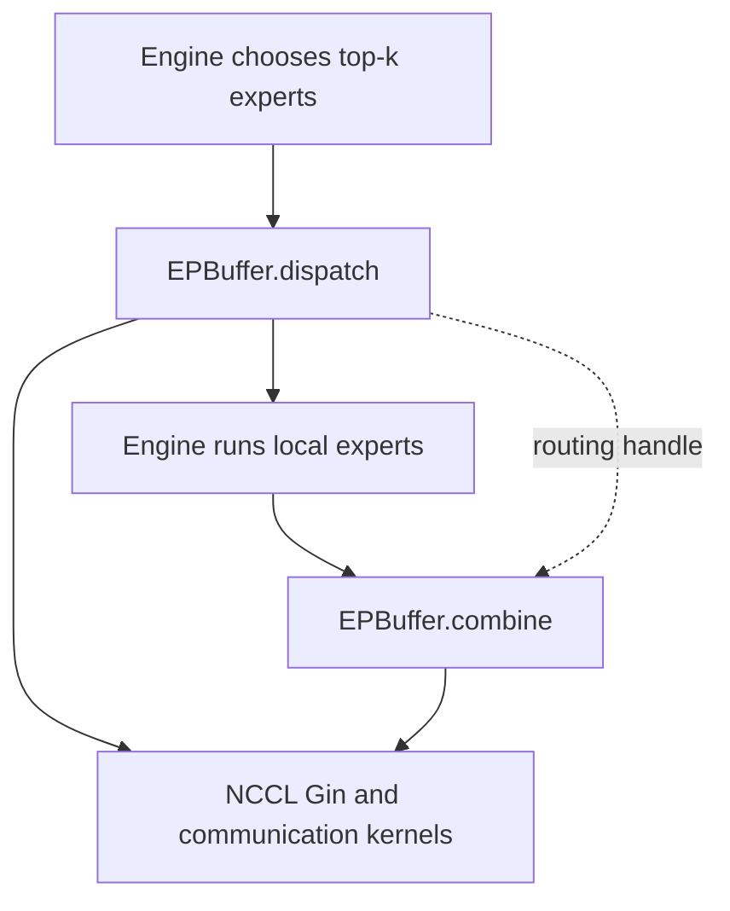

import SystemMap from '../../../components/SystemMap.astro';
import Source from '../../../components/Source.astro';

## Why it exists

A mixture-of-experts (**MoE**) layer routes each token to a small selection of
expert networks. Spreading experts across GPUs increases model capacity, but
creates a communication problem around every layer: activations must reach the
GPUs owning their selected experts, and contributions must return to the original
token owner.

DeepEP specializes that dispatch/combine boundary so communication can keep up
with expert computation. The model runtime still owns expert selection, expert
weights, computation and the model's gating mathematics.

## Where it fits

<SystemMap current="deepep" />

An engine supplies activation tensors, selected expert indices and optional
routing weights. DeepEP moves activations, returns receive metadata, and later
returns expert results using the matching route. This serves a different purpose
from moving request KV state between serving workers.

The pinned release uses `EPBuffer`, NCCL Gin device communication and specialized
GPU kernels. NVLink supports communication within a shared-address domain; RDMA
serves inter-node movement. Additional experimental buffer families are optional
extensions rather than stages of ordinary EP dispatch.

## Architecture overview

The solid arrows follow the layer's operation. The routing handle carries the
mapping needed to reverse dispatch; the engine performs the expert computation
between DeepEP calls.

`EPBuffer` owns reusable communication workspace and capacity for an expert-parallel
group. `EPHandle` describes one routing/layout assignment. The host layer validates
and prepares operations, while direct or hybrid kernels perform movement and
configured reductions. Events connect communication to the engine's compute stream.

## Follow an operation

1. Create the EP process group, agree on maximum token capacity, and construct
   an `EPBuffer` that can serve the planned layer.
2. The engine chooses experts and calls `dispatch` with its activations and routes.
3. DeepEP derives receive placement and moves tokens. The engine observes the
   completion dependency before consuming received tensors.
4. The engine computes every selected local expert contribution in the chosen
   receive layout.
5. `combine` uses the matching handle to return contributions to original token
   owners and perform the configured reduction. The next consumer waits for it.

Retain routing tensors unchanged and keep referenced storage live through all
asynchronous uses. Reusing a handle saves routing-layout work; new activations
still move on each dispatch.

## Decision gates

| Choice | Effect on the layer |
| --- | --- |
| EP group and expert placement | Define which rank owns each expert. |
| Non-expanded or expanded receive layout | Choose shared received rows or expert-grouped slots. |
| Exact counts or capacity outputs | Trade a CPU count wait for GPU-side valid-range handling. |
| Direct or hybrid communication | Choose flat peer movement or hierarchical forwarding. |
| Overlap and resource budget | Balance communication progress with expert compute while preserving dependencies. |

## Explore the code

Read the public contract, then follow dispatch and combine through the native
host layer into the selected kernels:

<Source project="deepep" path="deep_ep/buffers/ep.py" label="EPBuffer and EPHandle" />
<Source project="deepep" path="csrc/buffers/ep.hpp" label="Native operation preparation and finalization" />
<Source project="deepep" path="deep_ep/include/deep_ep/impls/ep/dispatch.cuh" label="Direct dispatch movement" />
<Source project="deepep" path="deep_ep/include/deep_ep/impls/ep/combine.cuh" label="Return movement" />

Start with [public contracts](/architecture/deepep/public-contracts/), then the
[complete layer trace](/architecture/deepep/dispatch-combine-trace/). Use the
layout, stream and kernel chapters when that boundary becomes your question.
