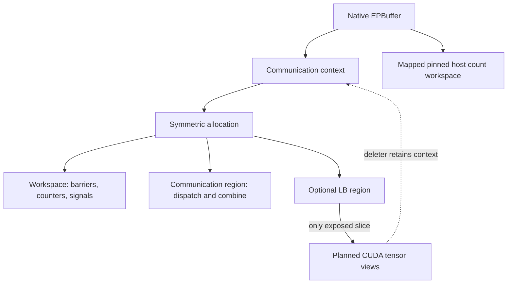

import Source from '../../../../components/Source.astro';

## Capacity belongs to the communication plan

`EPBuffer` owns reusable storage for an expert-parallel group. It reserves enough
space for the maximum planned traffic and keeps the communication context alive
across operations. The engine owns the input activations, expert weights and
application-level scheduling that produce that traffic.

Agree on maximum token capacity across the group before construction. Actual
token counts can differ across ranks and iterations, while the shared capacity
still defines the layout peers use to address one another's storage.

## Separate the memory regions

Workspace holds synchronization and protocol state. The communication region holds
dispatch/combine records. An optional load-balance region supports additional
expert parameter or gradient storage. These regions have different uses even
though the native context allocates them together.

The engine can provide explicit communication bytes or dimensional hints such as
maximum tokens, hidden width and top-k. Native sizing accounts for dispatch and
combine, chooses the larger requirement, and applies alignment. Activation payload
bytes alone therefore undercount the required allocation.

## Follow construction through reuse

1. The engine creates a compatible process group and capacity plan.
2. The Python buffer obtains a communicator handle and constructs its native
   context and symmetric storage.
3. Dispatch and combine reuse those resources for operations that fit the plan.
4. The engine retires all outstanding uses before replacing or destroying the
   buffer, then releases its group/communicator ownership in the appropriate order.

**Symmetric storage** gives participating GPUs compatible address layouts for
communication. Optional load-balance allocations use a `BufferAllocator` plan:
tensor offsets and shapes are settled before materialization into that storage.
Changing the plan requires a new compatible allocation rather than silently
moving live communication data.

## Decisions that change resource use

**Maximum capacity:** choose for the batching envelope the engine will submit.
Increasing it can consume more memory even when most iterations are smaller.
Exceeding it calls for a new group-compatible plan after prior work retires.

**Layout and precision:** expanded slots, scales, metadata and combine storage
all affect requirements. Use the native size helper for the selected operation
instead of estimating from one activation tensor.

**Lifetime:** Python returning from an asynchronous launch does not establish that
GPU readers have finished. Preserve input/output ownership and stream dependencies
through each operation, and coordinate buffer destruction across participating
ranks. Keep communicator ownership intact until that lifecycle ends.

The [stream chapter](/architecture/deepep/streams-and-events/) follows operation
lifetime; [precision and capacity](/architecture/deepep/precision-and-capacity/)
explains the main sizing choices.

## Read the code

<Source project="deepep" path="deep_ep/buffers/ep.py" label="Construction and size helpers" />
<Source project="deepep" path="csrc/buffers/ep.hpp" label="Native regions and buffer destruction" />
<Source project="deepep" path="deep_ep/buffers/allocator.py" label="Aligned load-balance allocation plans" />
<Source project="deepep" path="deep_ep/buffers/base.py" label="Shared buffer lifecycle" />
