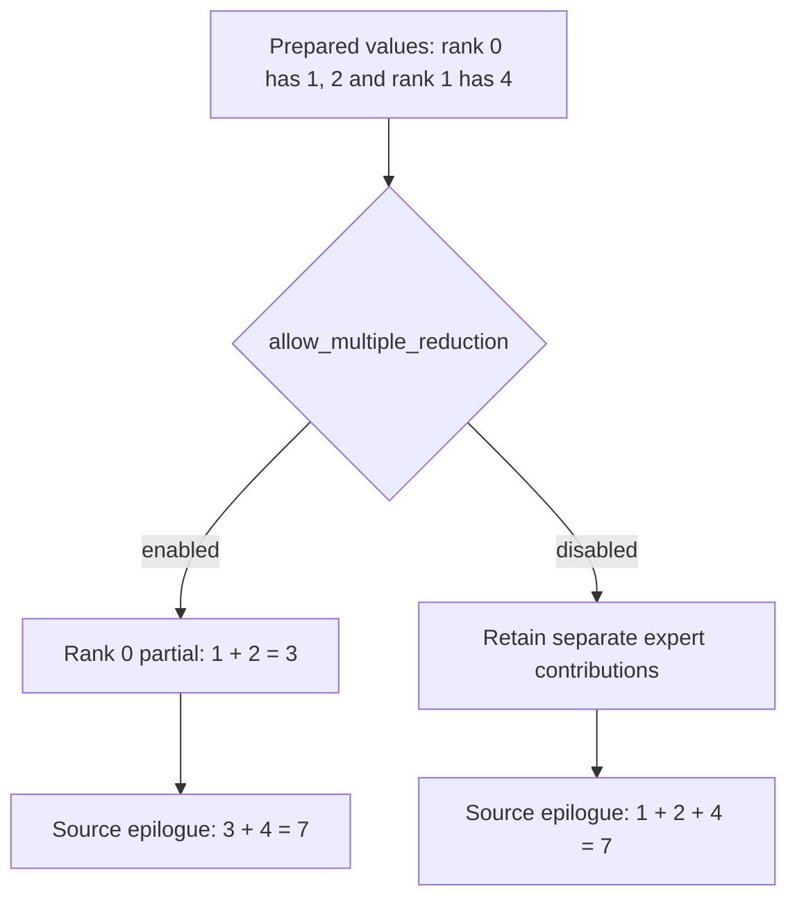

import Source from '../../../../components/Source.astro';

## Return contributions to the original token owner

After local expert computation, `combine` reverses dispatch. It uses the matching
handle to identify original tokens and their return slots, moves contributions
back, and launches the final reduction epilogue. The engine supplies expert
results with the semantics its model requires.

The handle is the connection between those stages: receiving an activation and
returning its contribution must agree on routing and layout even when receive
order or local expert grouping differs from source order.

## Follow the return path

1. The host validates expert outputs against the handle's layout and operation
   dimensions, then establishes the producer dependency.
2. The launcher selects direct or hybrid return movement and its configured
   reduction placement.
3. Communication kernels use source/forwarding metadata to return the prepared
   contributions to the original token owner.
4. The final epilogue reduces contributions into the source token's output and
   produces any returned top-k weight tensor.
5. The engine establishes completion before the next consumer reads that output.

The ordinary combine input is BF16 expert output. The received layout determines
whether local contributions have already been grouped or appear as expanded
expert slots. Supply the representation expected by the handle rather than
treating every received row as an independent original token.

## Choose where reduction happens

The teaching example has contributions 1, 2 and 4. Local reduction can first
produce 3 and then add 4, while a single final reduction sees all three. Both
produce 7 in exact arithmetic.

Allowing intermediate reductions can save return traffic by combining local or
domain contributions before they move farther. Deferring accumulation retains
more separate contributions for the final epilogue. Floating-point rounding can
depend on that grouping, so select the policy alongside the model's numerical
requirements rather than assuming communication placement is numerically invisible.

Activation reduction and returning top-k weights are separate outputs. The
integration remains responsible for applying its model's gating mathematics at
the intended stage.

## Keep finalization and ownership visible

The main return kernel and final tensor reduction are distinct stages. Deferred
combine returns a wait hook that produces the final outputs later; an asynchronous
ordinary result still needs the consumer-stream dependency.

Keep expert output storage and the matching route alive through those uses. A
communication kernel finishing part of the return route does not by itself grant
the next layer access to an unfinished final epilogue.

## Read the code

Follow public `combine` into native preparation, the selected movement kernel and
the final reduction:

<Source project="deepep" path="deep_ep/buffers/ep.py" label="Combine input and result contract" />
<Source project="deepep" path="csrc/buffers/ep.hpp" label="Native combine and finalization" />
<Source project="deepep" path="deep_ep/include/deep_ep/impls/ep/combine.cuh" label="Direct return movement" />
<Source project="deepep" path="deep_ep/include/deep_ep/impls/ep/combine_reduce_epilogue.cuh" label="Final source-token reduction" />
