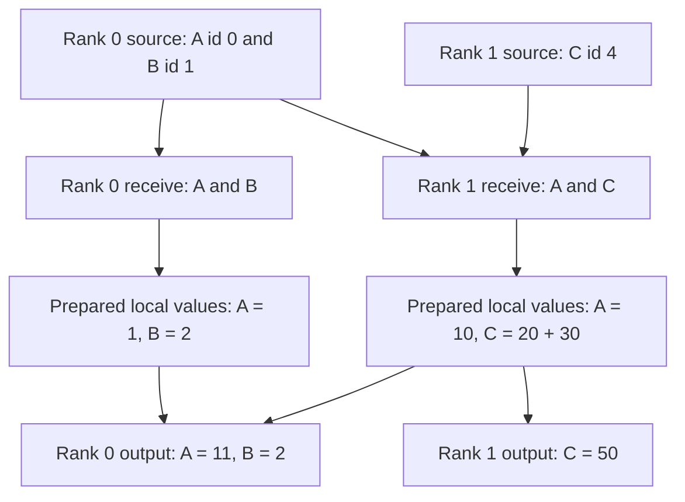

import Source from '../../../../components/Source.astro';

## Follow one complete MoE layer

Use two ranks and four experts: experts 0–1 belong to rank 0 and experts 2–3 to
rank 1. The engine supplies three source tokens, BF16 activations and top-k
selections. Choose non-expanded output and ordinary completion first so the
route is easy to follow.

The group shares a maximum capacity covering this example. The real vector
operations use a supported hidden width; scalar contributions below illustrate
ownership and addition rather than defining a kernel input shape.

## Predict the movement before launching

A selects experts 0 and 2, B selects expert 1, and C selects experts 2 and 3.
Rank 0 receives A and B; rank 1 receives A and C. C arrives once at rank 1 even
though it needs two expert contributions there.

The example separates source tokens, destination-rank rows and expert uses. That
distinction remains the same when the implementation changes its communication
route or expert-facing layout.

## Trace the main implementation handoffs

The engine calls `dispatch`. Python prepares its public arguments; native code
establishes the producer dependency, prepares count/placement metadata and launches
movement. The copy epilogue converts communicated records into receive tensors
and the matching `EPHandle`.

After observing the result dependency, each rank executes its local experts.
Use prepared scalar contributions A→E0:1, A→E2:10, B→E1:2, C→E2:20 and C→E3:30.
For this non-expanded example, the engine prepares local combined values A:1 and
B:2 on rank 0, and A:10 and C:50 on rank 1.

`combine` uses the handle's source identities and slots to return those values.
The final source outputs are A:11, B:2 and C:50. The network returns the results;
the engine owns how expert computation and gating formed those contributions.

## Change one architectural choice at a time

**Expanded layout:** the copy epilogue creates separate expert slots, so rank 1
has two C slots rather than one shared activation row. Expert results must match
that handle's layout when combine runs.

**Overlap:** establish a producer event and a result dependency around independent
compute. The route stays the same, while the execution schedule changes.

**Cached routing:** compatible unchanged selections can reuse placement for new
activation values. Changing a token's selected experts requires a fresh handle.

Through each variation, retain the buffer, routing storage and result inputs for
their full GPU-use interval. This keeps performance changes connected to the same
correct layer operation.

## Read the code in layer order

<Source project="deepep" path="deep_ep/buffers/ep.py" label="Dispatch, handle and combine" />
<Source project="deepep" path="csrc/buffers/ep.hpp" label="Native preparation and epilogues" />
<Source project="deepep" path="deep_ep/include/deep_ep/impls/ep/dispatch.cuh" label="Direct movement" />
<Source project="deepep" path="deep_ep/include/deep_ep/impls/ep/combine.cuh" label="Return movement" />
<Source project="deepep" path="deep_ep/utils/refs.py" label="Reference placement and reduction" />
