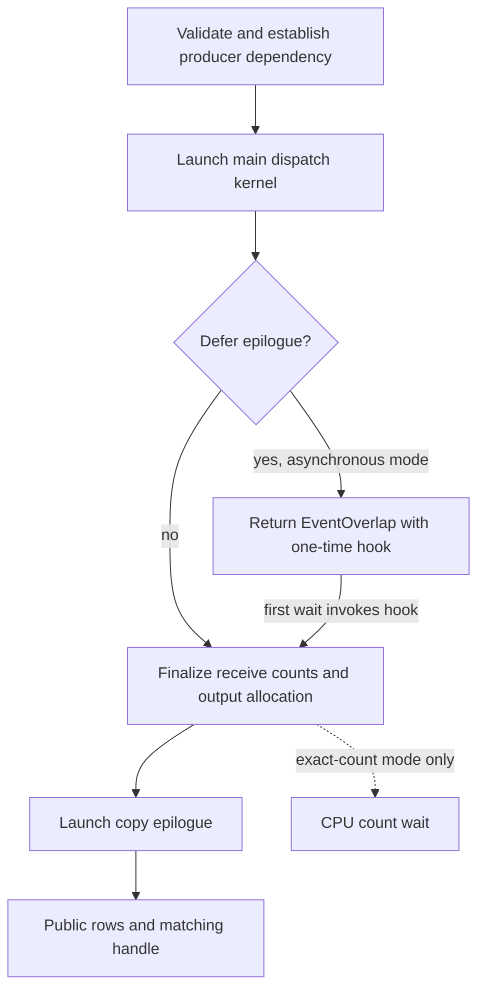

import Source from '../../../../components/Source.astro';

## The host prepares movement and the expert-facing result

Dispatch has two main GPU stages: communication fills internal records, then a
copy epilogue creates the tensor layout consumed by experts. The host validates
the operation, prepares metadata and controls when finalization occurs.

This boundary explains why Python-call latency can include more than the main
communication kernel. Count handling, output allocation and final layout work are
part of the operation the engine requested.

## Follow the ordinary dispatch

1. The Python wrapper interprets input representation and layout, obtains the
   selected communication resource budget and unpacks any compatible cached handle.
2. Native code checks inputs against buffer capacity and establishes the producer
   dependency on the communication stream.
3. Fresh dispatch prepares counts, destination slots and source/forwarding state,
   then launches the selected direct or hybrid communication kernel.
4. Finalization obtains output sizes, allocates receive tensors and launches the
   copy epilogue.
5. The wrapper constructs the matching handle and returns results with the
   completion dependency needed by the engine.

Validation protects the distributed layout established during buffer construction.
A larger local result allocation cannot compensate for source traffic that exceeds
the shared maximum-token plan.

## Choose when finalization occurs

Ordinary dispatch finalizes within the call. Deferred dispatch returns an event
wrapper whose wait hook performs finalization and yields the receive tensors and
handle. The hook is part of producing the public result, rather than merely
observing an already completed output.

The two important scheduling choices are:

| Choice | Effect |
| --- | --- |
| Exact counts versus capacity outputs | Wait for host-known receive sizes, or allocate conservatively and use GPU valid counts. |
| Immediate versus deferred finalization | Prepare the public outputs now, or let the caller run the finalizing wait hook later. |

Asynchronous-to-compute behavior is another boundary: it lets the compute stream
continue independent work while retaining a required dependency before expert
kernels read results. Deferral and device overlap solve different scheduling
problems.

## Follow metadata rather than every argument

Receive counts describe valid data, destination slots describe placement, and
source/forwarding metadata enables combine's reverse route. Direct and hybrid
operations create the structures their movement paths need.

For a first source trace, follow where those structures are created, passed into
the kernel, and captured by `EPHandle`. Read individual shape and alignment checks
when changing that interface. Before consuming output, establish the selected
event dependency and use the layout's valid ranges.

## Read the code

Read Python `dispatch` → native stream preparation → native dispatch → captured
epilogue → returned handle:

<Source project="deepep" path="deep_ep/buffers/ep.py" label="Dispatch arguments and result construction" />
<Source project="deepep" path="csrc/buffers/ep.hpp" label="Validation, metadata, launches and finalization" />
