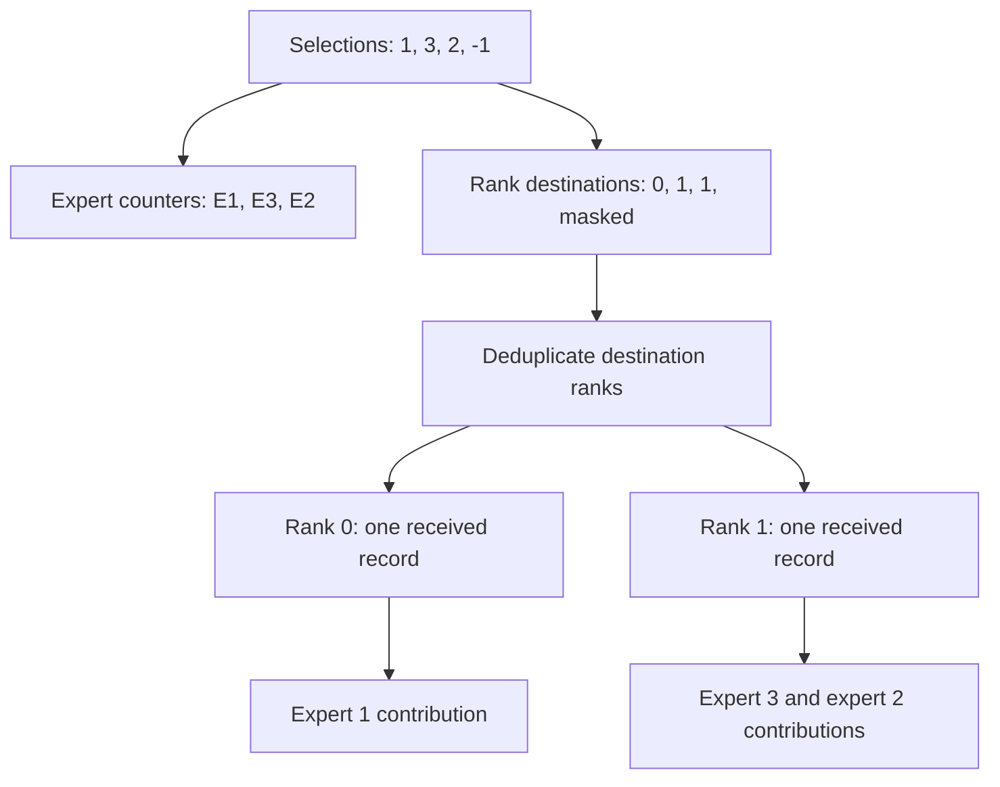

import Source from '../../../../components/Source.astro';

## Move one activation to each required destination

The dispatch kernel translates expert selections into communication records. It
must count destinations, place data and preserve source identity so the return
path can recover the original token owner. A copy epilogue then presents those
records in the expert-facing layout.

This chapter follows direct dispatch. A direct algorithm can communicate with
both local NVLink-accessible and remote RDMA peers; the hierarchical alternative
is covered in [hybrid communication](/architecture/deepep/hybrid-communication/).

## Deduplicate ranks while preserving expert work

In the teaching example, experts 3 and 2 share one destination rank. That rank
receives the activation once, while both expert contributions remain required.
Transport counts and expert counts therefore answer different questions.

The kernel separates work into roles. Counting/notification work establishes how
many records and expert uses are expected. Movement work packages activations,
optional scales, routing weights and source identity, then places records in the
selected peer slots.

The recorded source identity is essential: receive order can differ from source
order, and combine must still return each contribution to the correct token.

## Follow movement into public rows

For physically accessible peers, the implementation uses shared-address access.
For remote peers it uses NCCL Gin network movement. The launcher's topology and
resource configuration select the specialized implementation; the model router
still supplies the expert decisions.

Communication completion establishes the visibility needed by the dependent copy
epilogue. That epilogue reads records, localizes expert information and either
produces deduplicated rows or assigns expanded expert slots. It also creates the
metadata retained in the handle.

This is a useful three-stage trace: determine counts and slots, move records,
then materialize the public expert layout. It avoids confusing a record arriving
in workspace with a tensor being ready for arbitrary consumer kernels.

## Decisions and their owners

| Decision | Owner and consequence |
| --- | --- |
| Expert selections | Engine determines which contributions are required. |
| Direct or hybrid route | Initialized topology and launcher choose flat peer movement or forwarding. |
| Communication SM/QP budget | Runtime/integration balance movement resources against compute. |
| Expanded output | Engine matches the copy epilogue's output to its expert kernels. |

An SM is a GPU compute unit; communication kernels consume some of the same GPU
capacity as expert work. More communication resources can change overlap and
contention, rather than automatically improving the layer.

## Read the code

Start with the launcher and follow the selected implementation into the epilogue:

<Source project="deepep" path="csrc/kernels/ep/dispatch.hpp" label="Specialized direct/hybrid launch" />
<Source project="deepep" path="deep_ep/include/deep_ep/impls/ep/dispatch.cuh" label="Counts, records and direct movement" />
<Source project="deepep" path="deep_ep/include/deep_ep/impls/ep/dispatch_copy_epilogue.cuh" label="Public rows and reverse-route metadata" />
