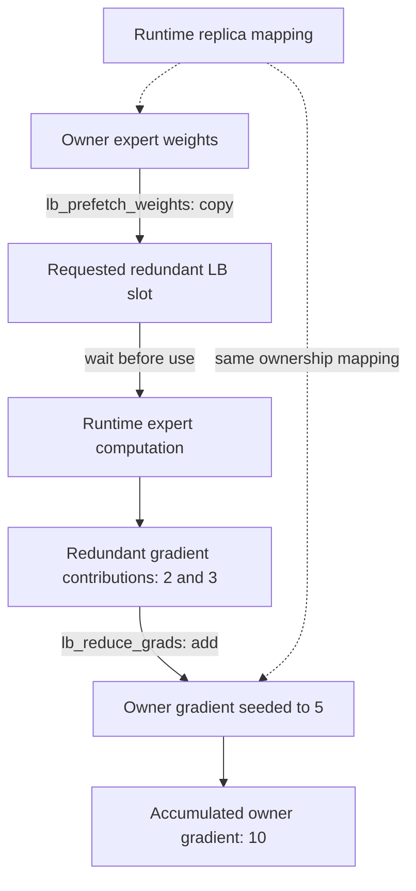

import Source from '../../../../components/Source.astro';

## Keep adjacent facilities separate from ordinary EP

DeepEP includes expert replication helpers and experimental communication APIs
beside token dispatch/combine. These share infrastructure but solve different
problems. A new developer can understand ordinary EP first, then enter these
facilities when the surrounding runtime needs their operation.

For replication, the model runtime chooses additional expert placements and how
to route work to them. DeepEP supplies weight movement and redundant-gradient
return primitives for that plan.

## Follow replica weights and gradient ownership

Within an NVLink domain, `lb_prefetch_weights` copies owner weights into the
requested redundant slots. The runtime waits for completion before computing
with them. The mapping is domain-local and must agree with the allocation and
expert placement used by that runtime.

`lb_reduce_grads` adds redundant FP32 gradients into the original owner's gradient.
In the scalar example, a destination seeded to 5 becomes 10 after contributions
2 and 3. The caller owns initialization and accumulation policy; repeating the
same reduction would add those contributions again.

The optional load-balance region is separate from token communication storage.
`BufferAllocator` plans its tensor views before materialization. Compatible
symmetric layout and event dependencies connect the replica mapping to usable
parameter and gradient data.

## Choose the facility by its operation

| Facility | Purpose |
| --- | --- |
| EP load-balance helpers | Push replica weights and add redundant gradients within the supported local domain. |
| Experimental `BucketBuffer` | Buffered all-gather, reduce-scatter and all-reduce under its group/storage contract. |
| Experimental `PPBuffer` | Bounded pipeline send/receive between adjacent ring participants. |
| Experimental `EngramBuffer` | Fetch indexed entries from registered storage shards into GPU buffers. |

The README marks the last three families experimental in this release. Each has
its own topology, capacity and completion requirements. A common buffer base does
not make their operations interchangeable with an EP routing handle.

## Decisions remain with the model runtime

**Placement and routing:** copying weights establishes a replica's contents. The
runtime must also select tokens for that replica and return results under the
correct expert/token mapping.

**Freshness and accumulation:** the runtime determines when weights may be used
and how gradients are seeded, added and eventually consumed.

**Lifetime:** buffer/session storage remains live through its asynchronous users.
Use each facility's completion contract before reusing that storage for unrelated
work.

These responsibilities keep the architecture legible: ordinary EP moves routed
activations, replication helpers move parameters/gradients, and other buffer
families expose separate communication patterns.

## Read the code

<Source project="deepep" path="deep_ep/buffers/ep.py" label="Load-balance allocation and weight/gradient contracts" />
<Source project="deepep" path="deep_ep/include/deep_ep/impls/ep/prefetch_weights.cuh" label="Replica weight movement" />
<Source project="deepep" path="deep_ep/include/deep_ep/impls/ep/reduce_grads.cuh" label="Additive gradient return" />
<Source project="deepep" path="README.md" label="Experimental families and platform scope" />
