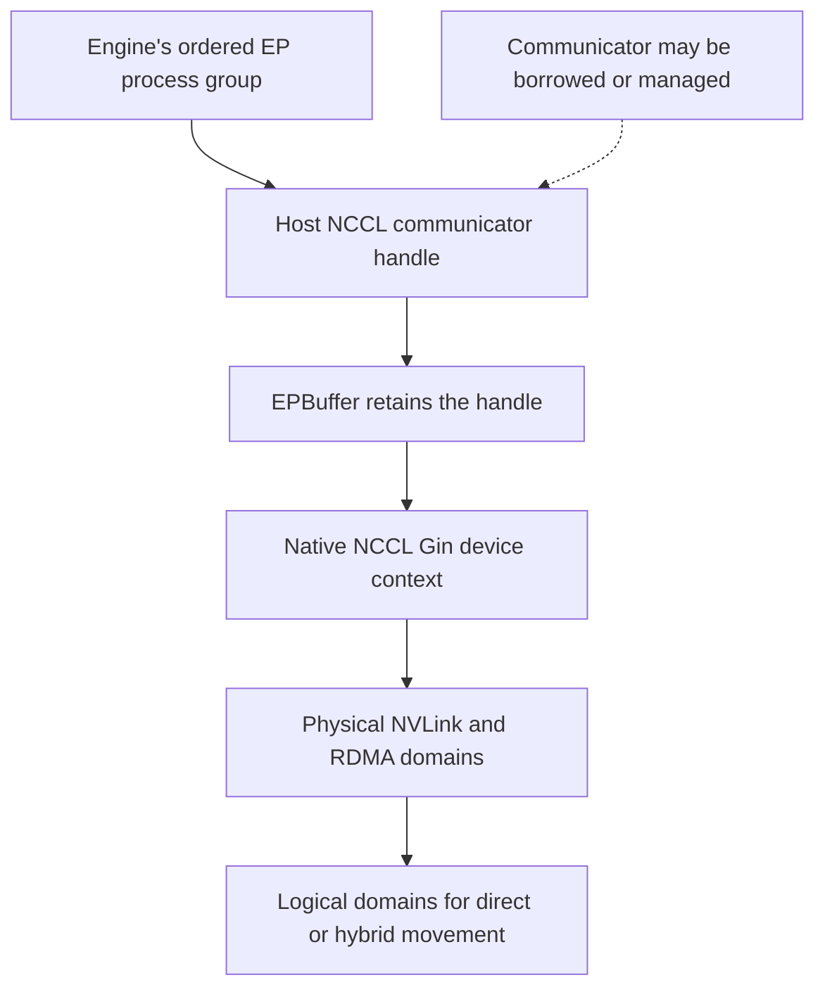

import Source from '../../../../components/Source.astro';

## Turn model membership into communication membership

The expert-parallel process group defines which processes participate and their
rank order. The engine constructs that group so its rank numbering agrees with
expert placement. DeepEP uses the group to acquire an NCCL communicator and create
the device communication context used by its kernels.

A successful connection establishes communication membership. Correct expert
execution also requires the model's expert-to-rank mapping to use the same order.

## Follow group construction into the device context

DeepEP can borrow a compatible backend communicator or create a managed one.
Borrowing preserves the backend's ownership; a managed handle owns its communicator
lifetime. `EPBuffer` retains the handle while its native device context uses it.

NCCL Gin supplies device-side network communication facilities. The loaded NCCL
and platform must support the requirements of this pinned release; the repository
README is the place to check that deployment contract.

## Separate hardware topology from algorithm coordinates

The physical shared-address domain identifies GPUs connected through the local
NVLink arrangement. Multiple such domains can communicate over RDMA. DeepEP's
logical domains describe how its chosen algorithm organizes those participants.

With hybrid communication, the hierarchy follows scale-out domains and their
scale-up members. A flat direct algorithm can instead treat the whole group as
one logical set while still using different physical transports for local and
remote peers.

For eight ranks on two four-GPU NVLink domains, the physical arrangement remains
two domains of four regardless of whether the algorithm uses a flat or hierarchical
route. Read the initialized context when interpreting that choice.

## Decisions that affect correctness and lifetime

**Group ordering:** subgroup-local rank numbers determine expert ownership within
that buffer. The engine translates any global model placement into that order.

**Topology and backend:** the operator supplies compatible devices, networking and
loaded libraries; the native context validates their capabilities and derives its
domain coordinates.

**Operation and teardown order:** participants must enter compatible operations.
Retire outstanding buffer work before destruction and keep the process group and
communicator alive through the context's use. Buffer teardown contains distributed
synchronization, so treat it as part of group lifecycle.

## Read the code

<Source project="deepep" path="deep_ep/comm/handle.py" label="NCCL communicator acquisition and ownership" />
<Source project="deepep" path="csrc/kernels/comm/context.cpp" label="Gin context and physical/logical domains" />
<Source project="deepep" path="deep_ep/buffers/ep.py" label="EPBuffer group and context ownership" />
<Source project="deepep" path="README.md" label="Pinned release platform requirements" />
