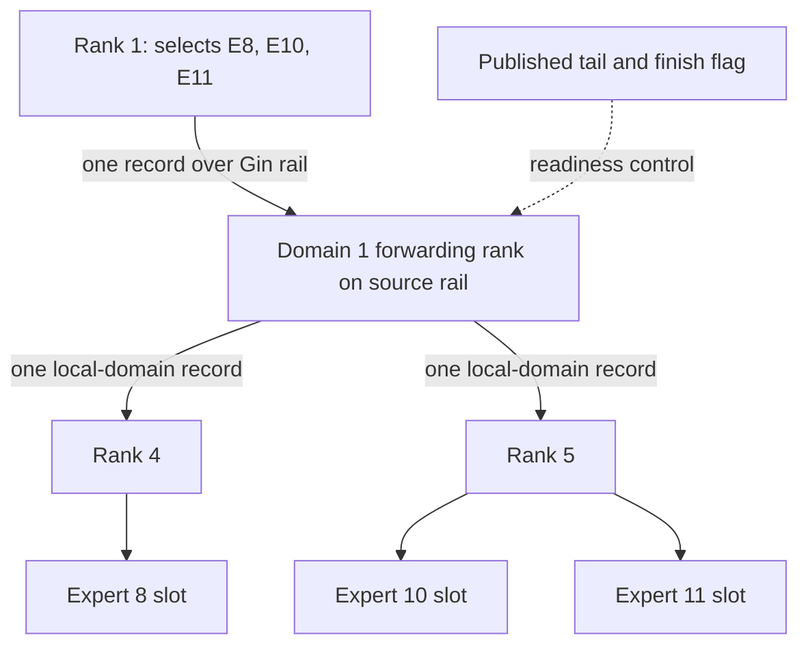

import Source from '../../../../components/Source.astro';

## Use the hierarchy to avoid duplicate cross-domain traffic

Hybrid communication separates a group of GPUs connected by NVLink from multiple
such domains connected over RDMA. A token selecting several experts in one remote
domain can cross the scale-out network once, then be forwarded to the required
GPUs inside that domain.

This saves repeated remote transfers at the cost of an additional forwarding
stage and metadata that records how the route must reverse during combine.

## Follow one token across the boundary

The example has two four-GPU NVLink domains and two experts per rank. A token on
rank 1 selects experts 8, 10 and 11 in the remote domain. One record crosses the
scale-out boundary, local forwarding creates records for ranks 4 and 5, and
expert expansion can produce three expert slots.

These counts describe different stages of one route. Three expert uses need not
mean three cross-domain copies.

## Separate counting, transport and forwarding

The launcher assigns GPU roles for notification/count work, scale-out movement
and local forwarding. Scale-out movement deduplicates destination domains and sends
records along NCCL Gin rails. A **rail** groups corresponding participants across
domains for that network arrangement.

Forwarding consumes arrived records and identifies the local destination ranks.
Published progress tells it which records are ready to read; allocated storage
alone does not establish readiness. The copy epilogue creates the public receive
rows and connects them to source and forwarding metadata.

Hybrid combine follows the recorded relationships in reverse: gather local expert
contributions, traverse the forwarding route, and return them toward their source
domain. Configured local/domain reductions can combine contributions before the
scale-out transfer. The final source epilogue completes the output layout.

## Decisions that change the route

**Flat or hierarchical:** the initialized logical domains select direct or hybrid
kernels. A flat direct route still distinguishes physical local and remote peers;
changing algorithm coordinates does not change hardware connectivity.

**Destination diversity:** several selected experts in one remote domain offer
different traffic-sharing opportunities from experts spread across many domains.
The model router supplies that distribution, while DeepEP implements movement.

**Resource budget and handle compatibility:** communication uses GPU resources
for forwarding and progress. Its channel geometry is part of the operation layout
retained by the handle. Reusing routing metadata must preserve the compatible
execution contract.

Start with this domain/rank/expert distinction before reading channel-tail loops
or metadata packing. It explains why hybrid handles contain more state than a
simple list of destination GPUs.

## Read the code

<Source project="deepep" path="csrc/kernels/comm/context.cpp" label="Topology and logical domains" />
<Source project="deepep" path="csrc/kernels/ep/dispatch.hpp" label="Hybrid role and launcher selection" />
<Source project="deepep" path="deep_ep/include/deep_ep/impls/ep/hybrid_dispatch.cuh" label="Scale-out movement and local forwarding" />
<Source project="deepep" path="deep_ep/include/deep_ep/impls/ep/hybrid_combine.cuh" label="Reverse forwarding and return movement" />
