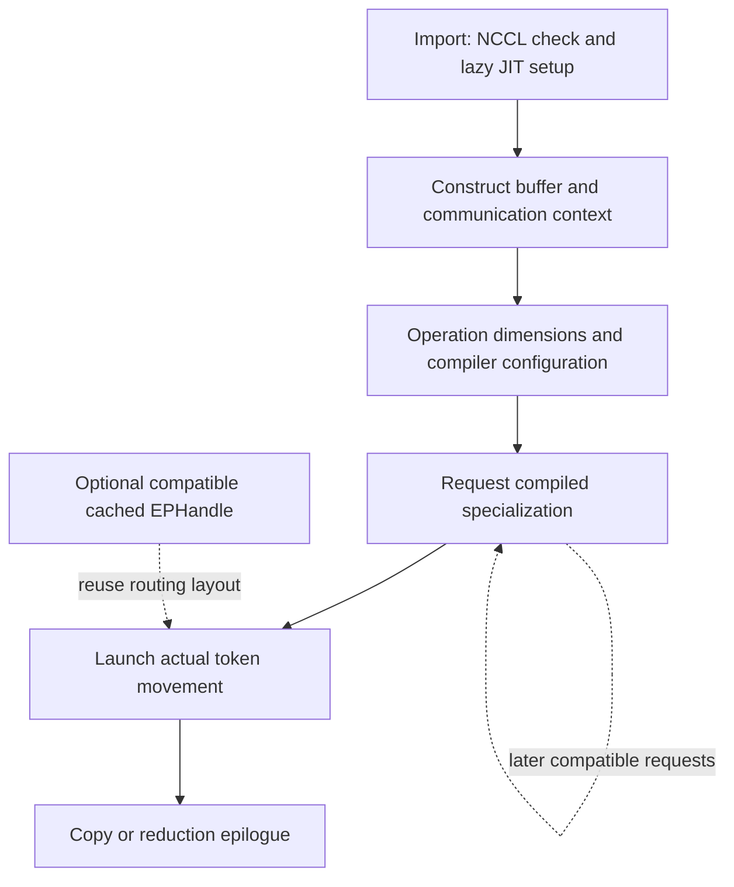

import Source from '../../../../components/Source.astro';

## Specialize kernels for the operation being launched

DeepEP combines native host entrypoints with runtime-compiled GPU communication
kernels. The host extension exposes buffer and operation control; DeepJIT prepares
specialized kernels for the selected dimensions, layout and resource configuration.

This separates installing the Python/native interface from preparing every GPU
variant a workload may later request. The first call to a specialization can
include compilation and warmup that later calls avoid.

## Follow the runtime layers

Compiled-kernel reuse and routing-handle reuse are independent. A warm compiled
kernel can execute new routing, while a cached routing handle still moves new
activations through the selected kernel.

Installation builds the native extension. Import initializes package discovery
and the lazy runtime compiler. Buffer construction establishes communication
resources. A dispatch or combine launcher then requests the GPU specialization
needed by that operation and launches its main kernel and epilogue.

The specialization captures dimensions and implementation choices such as hidden
width, top-k, direct/hybrid layout and communication resource geometry. Those
choices allow low-level GPU code to be generated for a bounded operation rather
than treating every combination as one generic kernel.

## Keep the two reuse boundaries clear

**Compilation reuse** avoids rebuilding a compatible GPU program. It can apply
across many fresh routing decisions that use the same specialization.

**Handle reuse** avoids recomputing compatible receive placement and reverse-route
metadata. It depends on the engine preserving the routing assignment and required
layout geometry. It does not promise that a new operation configuration requires
no compilation.

When tracing a first-call delay, identify which boundary is active before
attributing it to networking or expert load.

## Diagnose in lifecycle order

Start with package and loaded-library identity, then buffer/context construction,
kernel preparation, launch and completion. A compiler or missing-header failure
occurs before that specialization moves tokens. A distributed-progress stall
after launch belongs to a different stage.

Use the pinned README for supported GPUs, CUDA/toolchain and NCCL requirements.
Importing the package, compiling a kernel and establishing a ready communication
operation each provide evidence about a different boundary.

For performance work, warm the operation variants that the workload actually
uses, then compare steady-state dispatch/combine and whole-layer latency. Keep
the dimensions and effective compiler configuration with traces so an unexpected
new specialization can be explained.

## Read the code

Read build setup → import/runtime initialization → selected launcher:

<Source project="deepep" path="setup.py" label="Native extension build" />
<Source project="deepep" path="deep_ep/__init__.py" label="Package initialization" />
<Source project="deepep" path="csrc/runtime/jit.hpp" label="Lazy kernel compilation runtime" />
<Source project="deepep" path="csrc/kernels/ep/dispatch.hpp" label="Operation-specific dispatch specialization" />
<Source project="deepep" path="README.md" label="Pinned release runtime requirements" />
