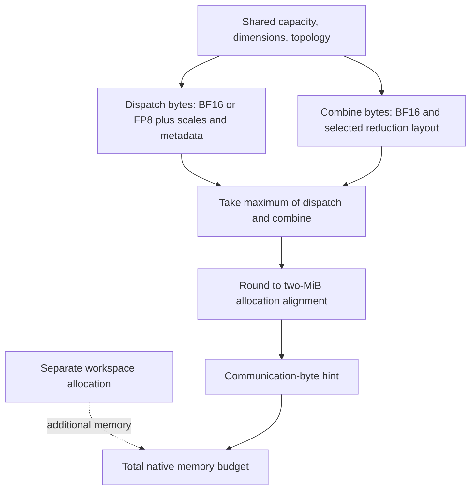

import Source from '../../../../components/Source.astro';

## Separate representation, capacity and execution budget

Three independent choices influence an EP layer: the representation of activations,
the reusable buffer's capacity, and the GPU/network resources assigned to movement.
Keeping them separate makes memory estimates and performance traces meaningful.

The engine supplies activation precision. The buffer reserves storage for the
planned operation. The runtime or integration selects communication resources
within that plan.

## Payload precision does not determine the whole allocation

Dispatch accepts BF16 activations or an explicit FP8 representation paired with
scale factors. Choosing an FP8-oriented size hint does not quantize the input;
the caller supplies those values and scales together.

The reusable allocation must also support combine, metadata, synchronization and
alignment. Native sizing takes the larger dispatch/combine communication
requirement, so a smaller dispatch payload need not shrink the whole `EPBuffer`.
Use that helper instead of estimating allocation from activation bytes alone.

## Track valid work within the chosen layout

All ranks agree on maximum token capacity, while actual traffic can vary. Expanded
expert slots can add local copies and padding. Exact receive sizing exposes
host-known counts after waiting; capacity-sized outputs retain valid-count
information on the GPU.

The expert consumer must honor those valid ranges. Allocated rows, deduplicated
received tokens and expert contributions are distinct quantities. The
[layout chapter](/architecture/deepep/token-layouts/) explains that interface.

Combine consumes BF16 expert outputs. Its reduction grouping is another numerical
choice: local/domain accumulation can reduce return traffic, while different
floating-point grouping can change rounding. Precision and reduction placement
should therefore be considered with the model's correctness requirements.

## Budget communication alongside compute

An **SM** is a GPU compute unit, and a **QP** is a network queue-pair resource.
DeepEP provides theoretical SM/QP estimates and accepts supported explicit
choices. These estimates model a workload; they are not measurements of the
application's actual routing or proof of an optimal allocation.

| Choice | Main consequence |
| --- | --- |
| Activation representation | Changes transferred values, scales and numerical error. |
| Maximum tokens and layout | Change reusable storage and valid-range handling. |
| Reduction placement | Trades intermediate traffic against accumulation grouping. |
| Communication SM/QP budget | Changes movement capacity and contention with expert compute. |

When comparing alternatives, keep topology and routing fixed first. Measure the
whole layer, including count waits and epilogues, alongside output correctness.
Then change one architectural choice so the result has an interpretable cause.

## Read the code

<Source project="deepep" path="deep_ep/buffers/ep.py" label="Representations, sizing and theoretical resource helpers" />
<Source project="deepep" path="csrc/buffers/ep.hpp" label="Dispatch/combine capacity and allocation" />
<Source project="deepep" path="deep_ep/include/deep_ep/impls/ep/combine_utils.cuh" label="Reduction grouping" />
