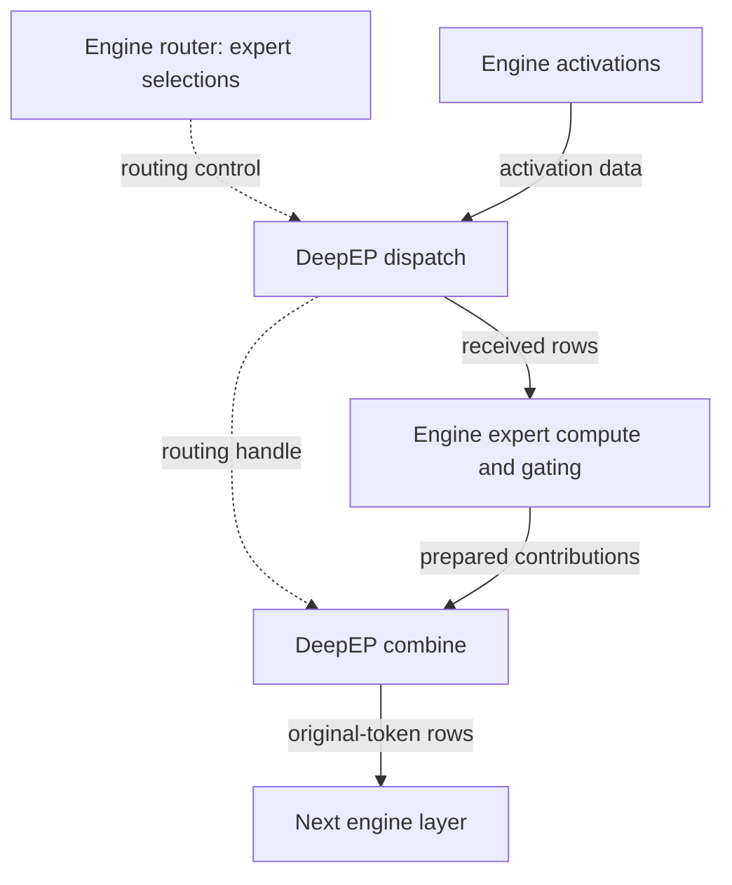

import Source from '../../../../components/Source.astro';

## Communication around an MoE layer

An MoE router chooses experts for each activation row. DeepEP's public contract
starts with those decisions already made: `dispatch` delivers tokens to the
selected expert ranks, and `combine` returns their prepared contributions.

The engine supplies activation values, expert indices and optional top-k weights.
It retains responsibility for expert computation and for implementing the model's
gating mathematics. This division lets the communication library specialize in
movement without becoming a model scheduler.

## Follow the owners

The handle connects dispatch placement to combine's reverse route. Completion
dependencies connect those operations to the engine's compute stream.

| Owner | Responsibility |
| --- | --- |
| Engine/router | Select experts, prepare tensors and compute expert contributions. |
| `EPBuffer` | Retain communication capacity and the native communication context. |
| `EPHandle` | Retain routing/layout metadata for the matching return operation. |
| Communication kernels | Move records, establish readiness and perform configured reductions. |

Ranks are participants in the expert-parallel group. Expert indices map model
choices onto those participants; they are not request identifiers or token counts.

## Use the ordinary call sequence

Construct one buffer for compatible operations and reuse its capacity across
layers or iterations. For a fresh route, `dispatch` returns receive tensors,
matching indices/weights, a handle and an event wrapper. Once the compute stream
has the required dependency, the engine consumes valid receive rows and computes
its local expert results. `combine` receives those results and the same handle,
then returns combined activations and any returned weight output.

For example, two selected experts on the same destination rank can share one
transported activation. The engine still computes both contributions. Choosing an
expanded receive layout instead groups separate activation slots by expert for
grouped expert kernels.

Keep routing storage unchanged while the handle is in use. A completed dispatch
does not end the handle's role: combine still needs its route and source identity.
The [routing chapter](/architecture/deepep/routing-and-handles/) explains that
ownership boundary.

## The consequential integration choices

**Layout:** match non-expanded or expanded output to the expert implementation.
The correct representation makes the next compute stage straightforward.

**Count handling:** exact output sizing can wait for GPU receive counts on the
CPU. Capacity-sized outputs avoid that wait but require the consumer to honor
GPU metadata identifying valid work.

**Completion:** asynchronous operation can overlap independent compute, while
consumers still need a result-event dependency. Deferred finalization additionally
requires executing the returned wait hook to produce its outputs. Those modes
are covered in [streams and events](/architecture/deepep/streams-and-events/).

## Read the code

Read `EPBuffer.dispatch` → `EPHandle` → `EPBuffer.combine`, then compare the
reference layer flow:

<Source project="deepep" path="deep_ep/buffers/ep.py" label="Public input, result and lifetime contracts" />
<Source project="deepep" path="deep_ep/utils/event.py" label="Returned event and deferred hook" />
<Source project="deepep" path="deep_ep/utils/refs.py" label="Reference dispatch/combine behavior" />
