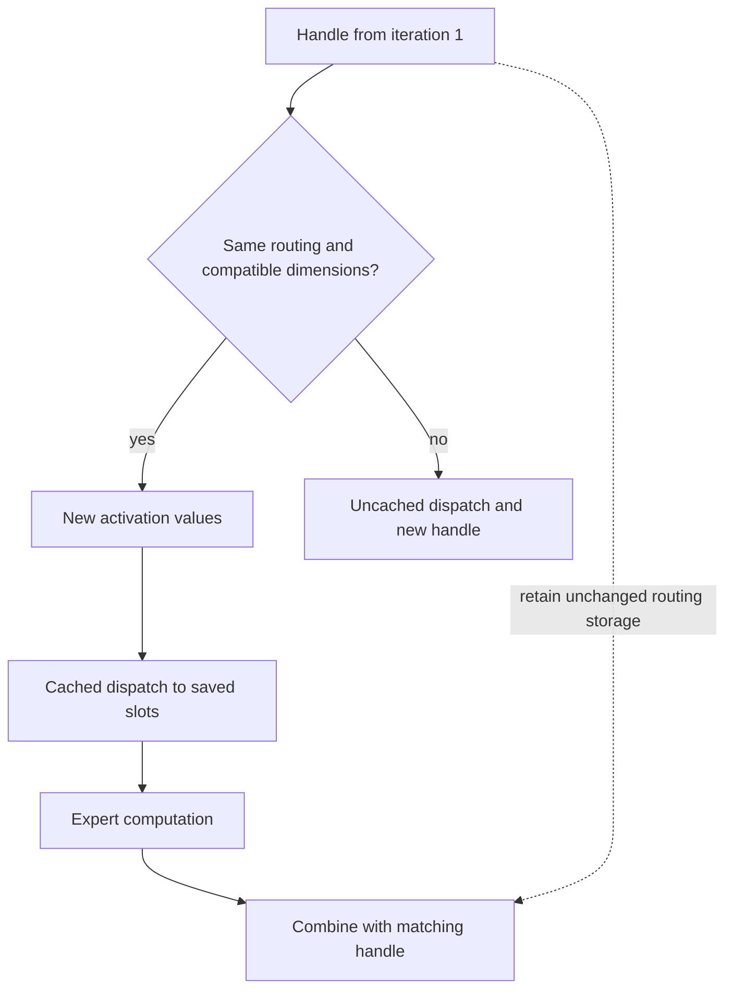

import Source from '../../../../components/Source.astro';

## A handle connects both journeys

The model router supplies `topk_idx`: expert selections for each source token.
DeepEP maps those experts to group ranks and records the receive placement. The
returned `EPHandle` connects that dispatch to combine, which must recover the
original token owner for every contribution.

The same handle can also reuse an unchanged route for later activation values.
That optimization reuses placement metadata; communication still moves the new
values to the recorded destinations.

## Keep route identity separate from values



The diagram shows a compatible second dispatch using the same layout. Changing
expert selections requires a fresh route, even when tensor shapes are unchanged.

The handle retains three useful categories of information:

| Information | Purpose |
| --- | --- |
| Original routing and operation dimensions | Define the assignment being reused or reversed. |
| Receive counts, expert ranges and destination slots | Identify valid work and where activations belong. |
| Source and forwarding metadata | Connect received rows back to original tokens, including hybrid routes. |

This metadata is execution state, rather than a new router decision. The engine
chooses when routing is compatible enough to reuse it.

## Preserve the routing tensor

The handle keeps the original routing tensor by reference:

```python
self._topk_idx = topk_idx
```

Keep that storage unchanged until all handle uses have completed. Retaining a
Python reference protects allocation lifetime; it does not prevent another part
of the engine from overwriting the same storage.

For example, A selects experts 0 and 2 across two ranks. A second activation for
the same selections can use the existing layout. Moving A's second selection to
expert 1 changes its destination and local expert work, so a new uncached dispatch
must establish the matching layout and return mapping.

## Decisions for reuse and layout

**Fresh or cached:** reuse only when the route and required layout/operation
geometry remain compatible. The API validates structural requirements, while the
engine remains responsible for the intended assignment.

**Expert layout:** non-expanded and expanded outputs have different slot
interpretations. Use the handle's corresponding metadata when supplying expert
results to combine.

**Ordering:** optional deterministic sorting moves values and related metadata
together. Source identity survives receive-row reordering, which is why callers
should use the handle rather than infer return ownership from row position.

Read [token layouts](/architecture/deepep/token-layouts/) for the receive side and
[streams and events](/architecture/deepep/streams-and-events/) before reusing live
routing storage asynchronously.

## Read the code

<Source project="deepep" path="deep_ep/buffers/ep.py" label="EPHandle ownership, cached dispatch and combine" />
<Source project="deepep" path="deep_ep/include/deep_ep/impls/ep/dispatch_copy_epilogue.cuh" label="Source metadata and receive-slot construction" />
<Source project="deepep" path="csrc/buffers/ep.hpp" label="Native cached-layout inputs" />
