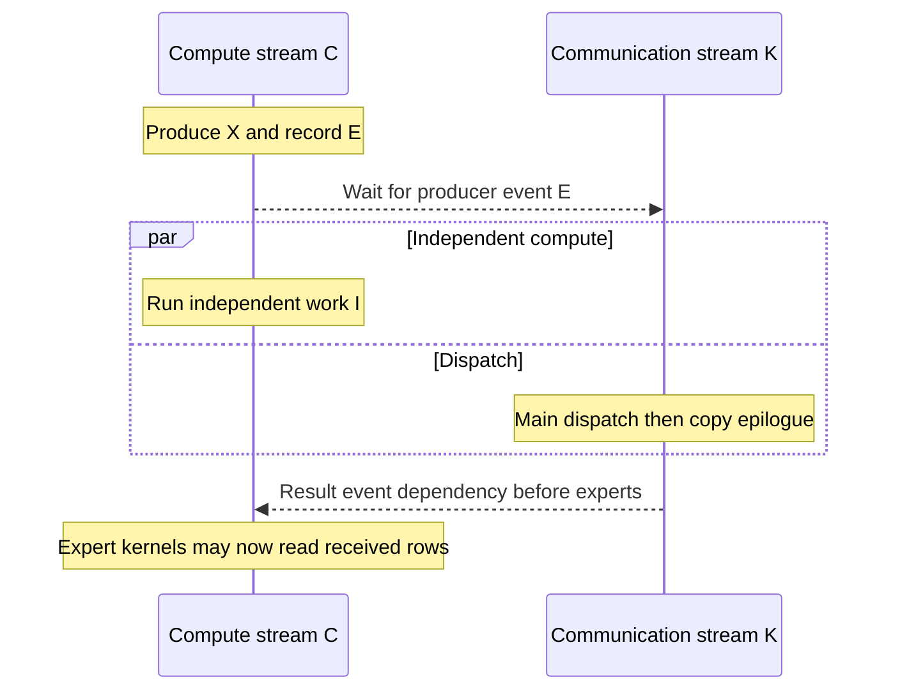

import Source from '../../../../components/Source.astro';

## Order communication around its producers and consumers

CUDA work is asynchronous with respect to Python. A stream orders its own queued
operations, while another stream needs an explicit dependency before accessing
their results. DeepEP uses a communication stream alongside the caller's compute
stream so useful independent work can overlap movement.

Two responsibilities remain separate: execution dependencies establish when data
may be read, and storage ownership keeps memory alive while those reads are queued.
Safe reuse requires both.

## Follow one overlap window

Compute produces activation X and records event E before queuing unrelated work.
Communication waits for E, performs dispatch and its copy epilogue, then exposes
a result dependency. The expert compute stream waits for that result before
reading receive rows.

This is device queue ordering rather than a CPU synchronization timeline. It
creates an opportunity for overlap; actual concurrency also depends on GPU
resource contention.

## Use the producer and result dependencies

Native stream preparation waits for a supplied `previous_event` or for preceding
work on the caller's current stream. Supplying the producer event can exclude
unrelated later compute from the dependency. This path requires communication-
stream allocation, as documented by the API.

Without asynchronous-to-compute mode, DeepEP inserts the corresponding wait on
the compute stream. With asynchronous mode, the caller uses the returned event
before its consumer. The dependency must be established on the stream that will
actually read the result.

Asynchronous native code also records tensor use or retains references for the
operation's lifetime. The engine must still avoid overwriting inputs and routing
storage while communication uses them. Keeping a reference alive protects
allocation lifetime; it does not order a new write.

## Deferred finalization adds a host action

Ordinary dispatch returns its receive outputs and an event wrapper. Deferred
dispatch returns the wrapper directly; its first `current_stream_wait()` executes
the captured finalizer and returns receive values, indices, weights and handle.
Deferred combine similarly produces its final outputs through the hook.

The wait hook therefore participates in producing results. Execute it before
launching consumers; receiving the Python wrapper does not yet provide the final
public outputs.

For a first integration, keep the ordinary ordered path clear. Add producer-event
overlap or deferred finalization only when the surrounding compute schedule can
use the window and preserve those ownership boundaries.

## Read the code

<Source project="deepep" path="csrc/buffers/ep.hpp" label="Stream-control prologue and epilogue" />
<Source project="deepep" path="csrc/comm/stream.hpp" label="Communication stream and event waits" />
<Source project="deepep" path="deep_ep/utils/event.py" label="EventOverlap waits and deferred hook" />
