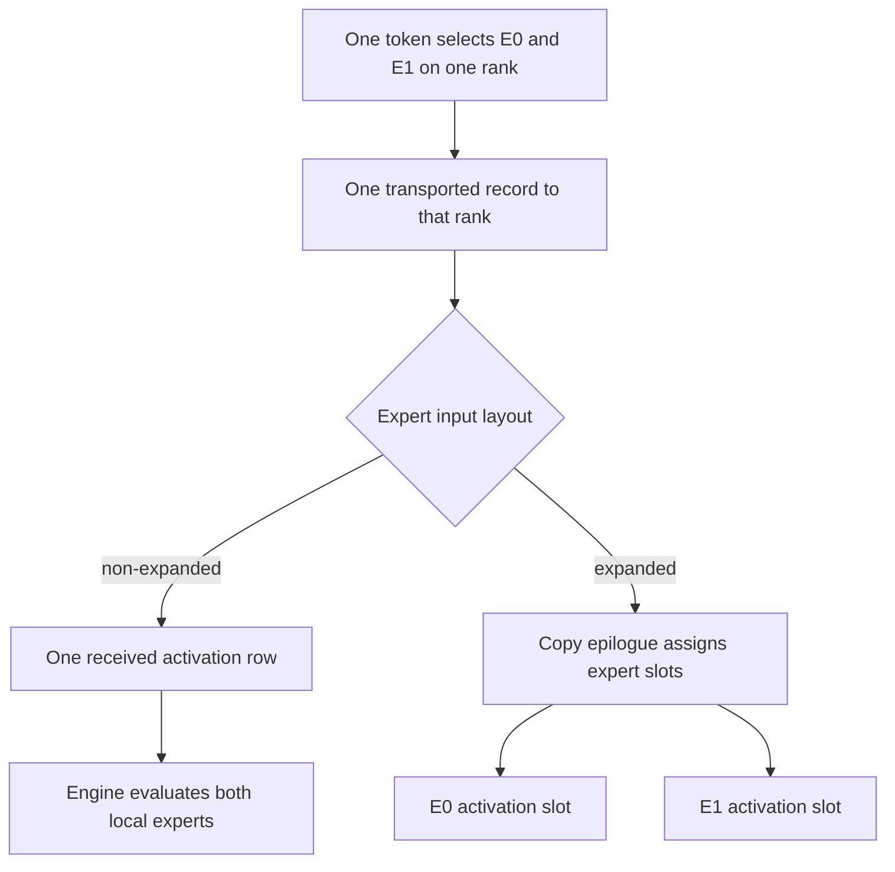

import Source from '../../../../components/Source.astro';

## Name the representation before counting rows

At the model boundary, a token is an activation vector and selected experts. In
the communication buffer, it is an aligned record with values, optional scales
and routing metadata. At the expert boundary, it becomes the input layout consumed
by local expert kernels.

Those representations have different row counts. Keeping them separate explains
transport deduplication, expert expansion and capacity without following every
internal byte offset.

## Choose the expert input layout

**Non-expanded** dispatch delivers one row per token per destination rank. Multiple
selected experts on that rank share the received activation; the engine computes
every valid local expert contribution. Received expert indices identify the local
selections.

**Expanded** dispatch assigns an activation slot to each selected local expert and
groups slots by expert. This suits grouped expert computation. The grouping and
handle metadata describe placement, so a separate received top-k index tensor is
not needed in this layout.

The output choice affects local compute layout. It does not imply a separate
cross-node transfer for every expanded copy.

## Valid work and allocated extent

Expanded ranges can include alignment padding. With actual expert counts three
and two and alignment four, five valid expert contributions occupy eight aligned
rows. The handle identifies valid counts and range boundaries; padding does not
add model work.

Two allocation strategies expose the same distinction:

| Strategy | Consumer responsibility |
| --- | --- |
| Exact receive sizing | Host waits for counts and allocates for the resulting layout. |
| Capacity-sized output | Consumer reads GPU metadata to bound valid work within the allocation. |

Avoid iterating over a capacity tensor's entire row count as if every row held a
received token. In expanded mode, follow the documented aligned starts and actual
ends/counts; the prefix metadata is layout-specific. The source docstring gives
the exact indexing convention when writing an expert kernel.

## Follow construction through the copy epilogue

The main dispatch kernel fills communication records and publishes routing/count
metadata. A copy epilogue converts those records into the requested public tensor
layout. Fresh expansion assigns expert slots; cached expansion uses the recorded
slots from its handle.

FP8 input carries scale factors alongside its values. The consumer must interpret
both under the returned layout. Treating values and scales as unrelated arrays
loses the representation the producer supplied.

For integration, track three quantities explicitly: source tokens, deduplicated
destination-rank rows, and expanded expert slots. For each, distinguish valid work
from allocated capacity. This makes the dispatch-to-expert boundary understandable
before inspecting low-level packing and alignment.

## Read the code

<Source project="deepep" path="deep_ep/buffers/ep.py" label="EPHandle range conventions and public layout choices" />
<Source project="deepep" path="deep_ep/include/deep_ep/layout/ep/token.cuh" label="Packed communication record" />
<Source project="deepep" path="deep_ep/include/deep_ep/impls/ep/dispatch_copy_epilogue.cuh" label="Fresh and cached expert-slot placement" />
