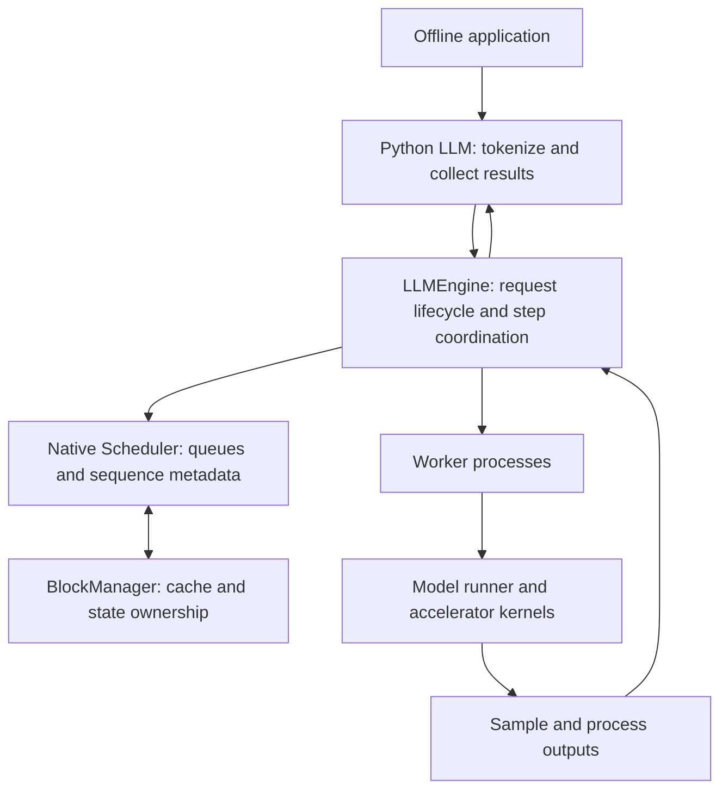

import SystemMap from '../../../components/SystemMap.astro';
import Source from '../../../components/Source.astro';

## Why it exists

Large mixture-of-experts models need more than fast kernels: scheduling,
memory ownership and communication must keep many accelerators productively
occupied. DeepInfer combines those responsibilities in an optimized model engine.
A developer can use its offline API to run a batch of prompts while the engine
coordinates the distributed execution beneath it.

This guide follows the released offline runtime. The pinned release targets
DeepSeek-V4.1-Flash and its listed accelerator platforms. External request routing,
shared KV infrastructure and complete serving orchestration are separate layers.

<Source project="deepinfer" path="README.md" label="Released model, platform and engine scope" />

## Where it fits

<SystemMap current="deepinfer" />

The public operation is `LLM.generate()`, which accepts prompts and sampling
parameters and returns collected results. **Sampling** selects output tokens from
model scores. A service can build around that engine boundary, but the offline
wrapper itself is not an HTTP frontend or replica load balancer.

## Architecture overview

Follow the request and result owners:

Python's `LLM` wrapper handles input preparation and result collection.
`LLMEngine` coordinates iterations and workers. The native C++ scheduler keeps
persistent sequences and chooses work, while `BlockManager` tracks cache/state
ownership. Workers build accelerator inputs, execute the model and sample output.
The return path reconciles that output with request state.

A **mixture-of-experts (MoE)** layer activates selected experts for each token.
Expert parallelism places expert work across devices; context and data groups
partition other parts of execution. These groups cooperate on the same job.

## Follow an operation

1. Configure model, devices, parallel groups and capacity limits, then construct
   the engine. Workers load weights and initialize cache before scheduling begins.
2. `LLM.generate()` prepares prompts and sampling parameters, assigns request
   identities and adds native sequence state to the engine.
3. Each iteration schedules work, reserves state, prepares worker inputs and
   launches model execution and sampling.
4. Output processing updates the corresponding sequences. Overlapped execution
   can retain a result until a later iteration; ownership follows that dependency.
5. The wrapper clones pooled output objects, flushes final in-flight results,
   orders results by request ID and returns them to the application.

That last boundary matters: a raw native output handle identifies pooled storage.
The wrapper's owning clone preserves the result across later engine steps.

## Decision gates

| Choice | Effect on the architecture |
| --- | --- |
| Released model and platform | Select compatible model construction, kernels and toolchain. |
| Parallel group sizes | Divide attention/context and expert work across cooperating ranks. |
| Token/cache budgets | Trade concurrent work against memory capacity and admission. |
| Overlap and speculative execution | Improve useful utilization while adding retained-state and verification boundaries. |

Begin with the repository map, startup and offline lifecycle. Read deeper model,
memory or communication chapters when the corresponding boundary matters.

## Explore the code

Follow the wrapper into engine coordination, scheduling and worker execution:

<Source project="deepinfer" path="deepinfer/entrypoints/llm.py" label="Offline entrypoint and collection" />
<Source project="deepinfer" path="deepinfer/engine/llm_engine.py" label="Engine lifecycle and steps" />
<Source project="deepinfer" path="csrc/engine/scheduler.hpp" label="Native scheduling" />
<Source project="deepinfer" path="deepinfer/worker/worker.py" label="Worker execution and deferred results" />
