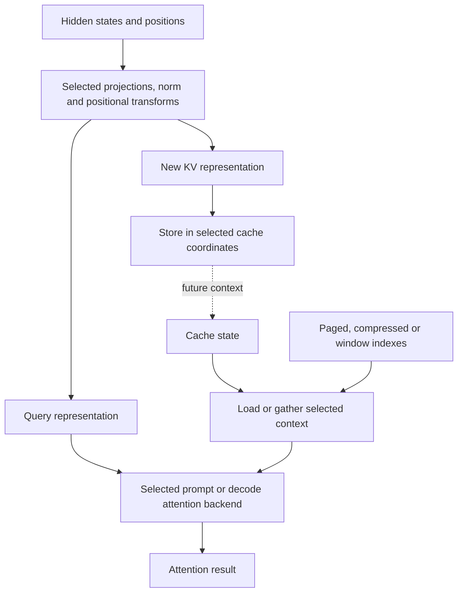

import Source from '../../../../components/Source.astro';

## Connect a decoder layer to its state

DeepInfer's released V4.1 model family uses specialized attention representations,
including low-rank projections and selected compressed, sparse or windowed cache
paths. To trace it, connect model construction to the runtime representation and
then the selected attention backend.

The model builder creates parameter containers. Runtime decoder components turn
those parameters into execution modules, connecting attention, residual/state
handling and MLP/MoE work. A checkpoint parameter name can therefore pass through
layout transformations before a kernel consumes it.

## Follow queries and cached context separately

The map separates semantic responsibilities. Projections and positional transforms
prepare query and KV representations. New KV state is stored into the selected
cache coordinates; earlier context is loaded or gathered through its indexes.
The selected attention backend consumes the appropriate query and context views.

A fused helper can combine several stages without removing those responsibilities.
Track the representation on each side of the helper, rather than inferring data
layout from its function name.

## Why the cache needs explicit indexes

Logical token position is a sequence coordinate. Physical cache storage can be
paged, compressed, windowed or shared across selected layers. Those layouts
serve different model roles and do not all use one token-to-row mapping.

For a first trace, identify the layer's model configuration, step type and cache
view. Then follow its positions and indexes from input metadata into the store
and load operations. The useful invariant is that query/context representations
refer to the intended request state under the selected layout.

Low-rank projection is another distinct idea: it factors a transformation through
a smaller intermediate representation. That model representation choice is
separate from partitioning tensors among devices.

## Decisions that change execution

| Choice | Main effect |
| --- | --- |
| Layer/model configuration | Selects the attention and state representations. |
| Prompt or decode step | Changes current query work and use of existing context. |
| Cache sharing/compression | Changes where state lives and how later layers or tokens access it. |
| Available backend/fused path | Chooses the implementation for compatible representations. |

Begin with one configured layer and the ordinary main-model path. Draft-model
attention and model-specific backend alternatives can be traced from their own
call sites when needed. Listing every fusion gate first obscures the common
query → state access → attention result path.

## Read the code

<Source project="deepinfer" path="deepinfer/model_executor/models/v4_modules/builder.py" label="Parameter construction" />
<Source project="deepinfer" path="deepinfer/model_executor/models/decoder_layer.py" label="Runtime decoder composition" />
<Source project="deepinfer" path="deepinfer/model_executor/models/v4_modules/attn.py" label="Attention representations and cache operations" />
<Source project="deepinfer" path="deepinfer/model_executor/layers/attention_backend.py" label="Selected kernel boundary" />
