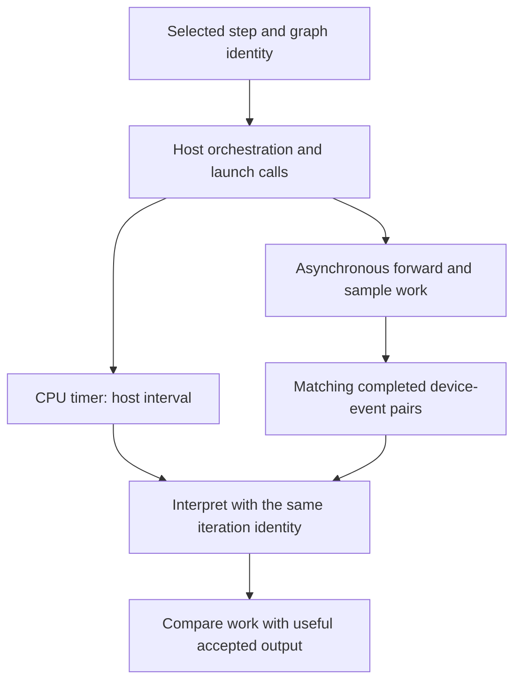

import Source from '../../../../components/Source.astro';

## Locate the owner of a symptom

Diagnose a concrete configured job: selected model, parallel layout, capacity
limits and enabled execution strategy. Then follow the first boundary where
observed behavior differs from the expected request path.

A slow or incorrect result can originate in admission, input identity, model work,
communication, verification or output ownership. One throughput number cannot
identify which owner to inspect.

## Match measurements to the work they describe

CPU timing measures host orchestration and launch intervals. Device events measure
the corresponding accelerator intervals after completion. Associate observations
with the correct step and graph identity before combining them.

This matters especially under overlap: the host can process a prior result while
launching current work. A timer visible during iteration B may describe completed
work from A. Preserve that identity in an investigation rather than labeling every
measurement as current model latency.

## Trace the symptom through the main path

| Symptom | First boundary to inspect |
| --- | --- |
| Request waits while devices have capacity | Scheduler queue, group step choice and admission limits. |
| Plausible execution produces wrong context | Request identity, input metadata and cache coordinates. |
| Expert work is uneven | Logical routing demand, physical placement and communication. |
| Results change after another step | Pooled native output ownership and cloning. |
| Work ends but the final result is missing | Retained worker state and final output flush. |

Keep one request or iteration in view. Record its selected work, current owner,
relevant memory references and observed completion. That creates a causal trace
into the implementation instead of a checklist of unrelated configuration flags.

## Separate useful output from launched work

Speculative decoding may execute several candidates that produce fewer accepted
tokens. Compare device work and communication with accepted progress, not only
scheduled positions. Similarly, an expert rebalance can improve distribution while
adding weight-movement cost.

Inspect the actual selected mechanism when explaining performance. A policy change,
a new input layout and a different backend can affect different stages even when
the public generation call stays the same.

For correctness, follow the return path through sequence reconciliation, output
cloning and drainage. Close the engine after the job finishes so worker and native
resource ownership also reaches a terminal boundary.

## Read the code

Start with the offline example and statistics, then choose the subsystem matching
the symptom. Focused upstream tests become useful after that owner is known; their
fixture inventories need not be part of the first architecture trace.

<Source project="deepinfer" path="examples/offline_inference.py" label="Concrete offline job" />
<Source project="deepinfer" path="deepinfer/engine/stats_logger.py" label="Statistics and useful progress" />
<Source project="deepinfer" path="deepinfer/timer.py" label="Timer scopes" />
<Source project="deepinfer" path="deepinfer/worker/worker.py" label="Completed device events, result processing and flush" />
