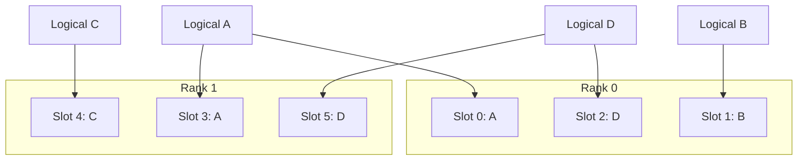

import Source from '../../../../components/Source.astro';

## Balance the work behind sparse activation

A mixture-of-experts layer routes each token to selected experts. Sparse
activation reduces computation per token, but demand can concentrate on a few
experts and leave some devices waiting. Expert load balancing changes physical
placement or redundancy so the model can use the group more effectively.

The key distinction is between a logical trained expert, a physical weight copy,
and the local slots owned by one rank.

## See one logical-to-physical mapping

This teaching placement contains redundant copies of A and D. Arrows identify
physical owners of the same logical weights, rather than token traffic or a
predicted placement policy result.

Model routing chooses logical expert work. The runtime's mapping selects physical
copies and local slots for that work. Redundancy changes where an expert can run;
it preserves the trained function associated with its logical identity.

## Follow the balancing path

The model collects expert demand. A history-driven policy uses those observations
to produce a placement and corresponding forward/reverse maps. The runtime then
moves or copies weights into their intended local slots and publishes compatible
routing information.

That last stage is essential. A valid placement table alone does not establish that
the weights have reached those slots. The shuffle implementation plans local and
remote movement, uses temporary storage where needed, and waits for required
communication before installing the result.

Mapping publication and outstanding model work also need a coordinated boundary.
Publishing new routes too early can select stale weights; overwriting old storage
while it still has readers can corrupt in-flight computation. Treat the placement,
actual tensors and routing state as one reconfiguration operation.

## Decisions that change the tradeoff

**Redundancy:** more physical copies can distribute hot-expert demand but consume
parameter memory. The loader resolves compatible storage before execution.

**Placement:** runtime policy uses observed demand to choose which logical expert
occupies each physical slot. A balanced slot count alone does not guarantee
balanced token work.

**Update cadence:** moving weights costs memory bandwidth, network work and
coordination. The benefit of a new placement must justify that cost for the
workload and topology.

Begin at the model's expert execution, then follow demand collection, policy,
shuffle and map installation. That path separates a model-routing question from a
physical movement or resource-lifetime question without enumerating each kernel
and pairing strategy.

## Read the code

<Source project="deepinfer" path="deepinfer/model_executor/models/v4_modules/moe.py" label="Logical routing and physical expert execution" />
<Source project="deepinfer" path="deepinfer/model_executor/eplb/policy.py" label="History-driven placement policy" />
<Source project="deepinfer" path="deepinfer/model_executor/eplb/shuffle.py" label="Weight movement and staging" />
<Source project="deepinfer" path="deepinfer/model_executor/eplb/__init__.py" label="Layout resolution and runtime map updates" />
