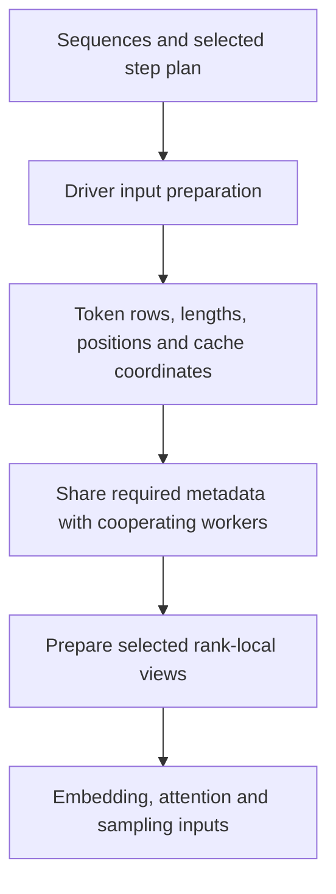

import Source from '../../../../components/Source.astro';

## Turn a schedule into accelerator inputs

A scheduler chooses requests and token work. Kernels need tensors describing
input IDs, positions, lengths, valid rows and cache locations. Input preparation
translates between those representations while preserving request identity.

The driver model runner builds the selected metadata; cooperating workers receive
the information needed for their group and local view. Model-specific preparation
then constructs the exact cache and attention inputs.

## Follow the preparation boundary

The arrows show representation handoffs. Model configuration and parallelism
choose local layouts; the diagram does not prescribe one physical row order for
every path.

## Keep the coordinate systems distinct

Suppose A contributes three query tokens and B contributes one. Flattened query
rows are `[A0, A1, A2, B0]`, with boundaries `[0, 3, 4]`. A can still have a much
longer existing context than B. Query length counts this step's work; context
length describes what attention can read.

| Metadata | Meaning |
| --- | --- |
| Token IDs and positions | Input values and original sequence coordinates. |
| Query boundaries and context lengths | Per-request work and available history. |
| Valid-row information | Real work within any padded execution capacity. |
| Cache/index mappings | Where the selected representation stores or loads state. |

Graph capacity, real token count and number of requests can differ. Context
parallelism can also reorder work into rank-local views. Treating every index as
an original token position hides the transformation the metadata is encoding.

## Preserve identity across iterations

Overlapped execution can prepare current work before prior results are fully
reconciled on the host. The worker corrects the selected metadata using the
corresponding prior result. Matching is by request identity, not an assumption that
the same row number still names the same request.

The main decisions are the step type, selected model path, parallel layout and
execution capacity. They determine which preparation routine and views are needed.
Trace those choices before reading individual tensor arithmetic or backend fields.

A useful source investigation follows one request through sequence metadata,
flattened rows, local/cache mappings and returned sampling rows. That connects
numerically plausible tensors to the application request they actually represent.

## Read the code

<Source project="deepinfer" path="deepinfer/worker/model_runner.py" label="Driver/follower input preparation" />
<Source project="deepinfer" path="deepinfer/model_executor/input_metadata/input_metadata.py" label="Shared metadata and coordinate fields" />
<Source project="deepinfer" path="csrc/engine/input_metadata/prepare_tensor_input_v4.cpp" label="Native model-specific input construction" />
<Source project="deepinfer" path="deepinfer/model_executor/input_metadata/prepare_tensor_input_zos.py" label="Overlapped execution metadata correction" />
