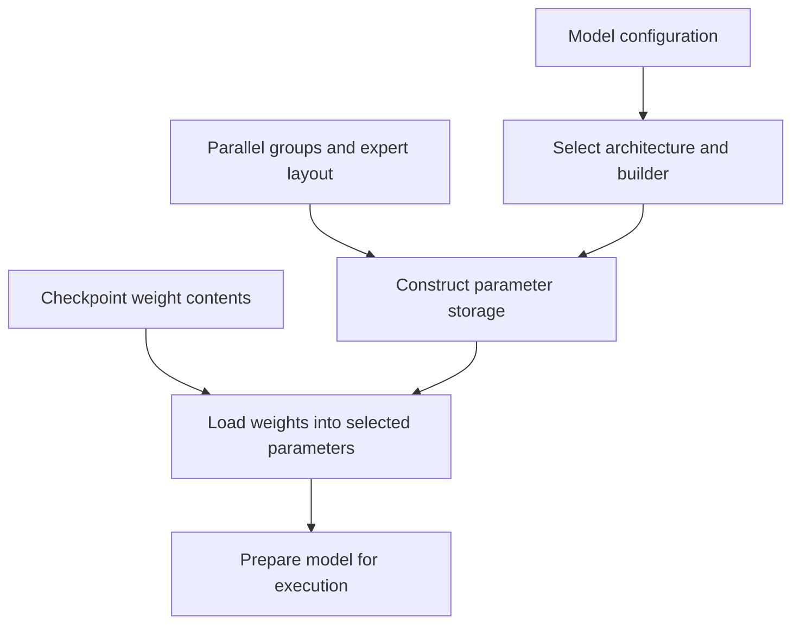

import Source from '../../../../components/Source.astro';

## Make parameters match the execution layout

A checkpoint supplies trained model state. The loader must construct the right
architecture and place those weights into parameters shaped for the selected
parallel job. Model identity, checkpoint representation and rank-local placement
are related choices with different owners.

DeepInfer's released model family uses specialized attention and MoE components.
Begin at architecture resolution rather than assuming a generic transformer
loader explains every parameter.

## Follow construction into loading

This is a dependency map. The loader resolves runtime-dependent model settings
before allocating the corresponding expert and parameter storage.

Architecture lookup chooses the model implementation. Model configuration supplies
dimensions and features; the builder constructs components; checkpoint loading
fills their parameter contents. Runtime preparation then selects the execution
representations needed by the worker.

## Expert redundancy changes physical storage

A **logical expert** is a trained function selected by model routing. A physical
expert slot stores one copy of its weights, and a rank owns its local slots.
Redundant physical copies can help balance demand without changing logical expert
identity.

The loader resolves the requested redundancy into a physical expert count
compatible with the expert group. Parameter allocation, loaded contents and routing
maps must agree on that result. The important boundary is finalizing placement
before filling the storage that workers will execute.

Checkpoint coverage validation helps catch missing or mismatched state before
execution. When diagnosing loading, first identify the selected architecture,
resolved layout and expected parameter coverage; only then inspect individual
weight transfers.

## Decisions that change the path

**Model/platform scope:** use an architecture and toolchain supported by the
released runtime. Specialized kernels and representations follow that choice.

**Parallel placement:** group sizes and redundancy determine local storage and
which checkpoint contents each worker needs. Capacity and communication costs
follow from that physical layout.

**Artifact lifetime:** a checkpoint or published shard set must remain a stable
snapshot while workers load it. A correct configuration cannot compensate for
workers seeing inconsistent weight versions.

These choices explain the loading architecture. Quantization variants, individual
parameter remappings and coverage exceptions can be followed in the selected
loader when changing that implementation.

## Read the code

<Source project="deepinfer" path="deepinfer/model_config_loader.py" label="Model configuration loading" />
<Source project="deepinfer" path="deepinfer/model_executor/models/__init__.py" label="Architecture resolution" />
<Source project="deepinfer" path="deepinfer/model_executor/model_loader.py" label="Runtime layout resolution, construction and loading" />
<Source project="deepinfer" path="deepinfer/hugging_face/loading.py" label="Checkpoint contents and coverage" />
