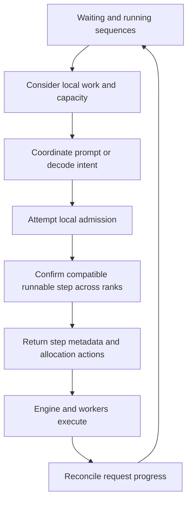

import Source from '../../../../components/Source.astro';

## Choose useful work that cooperating ranks can execute

The native scheduler owns persistent queues and selects each iteration's work.
It balances prompt processing, decode progress and finite cache capacity. Moving
that policy into C++ reduces orchestration overhead while preserving the same
architectural questions: what can run, what must wait, and what execution state
must survive afterward?

A `Sequence` holds request identity and progress. `SequenceMetadata` describes
selected work for one step. `SchedulerOutputs` carries that selection and the
state-allocation actions needed by the engine.

## Follow the normal scheduling loop

The graph summarizes the ordinary coordinated path. A prompt attempt must still
admit actual work somewhere in the group; intent alone is insufficient. Ranks
without local prompt work can participate with compatible empty work so their
subsequent operations remain aligned.

The engine consumes allocation actions before the next scheduling call reuses
its per-step storage. That handoff connects logical admission to physical state
copying and worker inputs.

## Understand the two main resource decisions

**Prompt versus decode:** prompt work initializes context; decode advances existing
requests. The normal engine coordinates this choice across its data group because
those ranks later participate in compatible model communication. Local queue
policy therefore has a distributed consequence.

**Admission versus waiting:** token budgets, sequence limits and available
cache/state determine whether candidate work fits. Chunked prefill lets a long
prompt make partial progress. Under pressure, policy can defer or preempt work;
recovery depends on the selected engine mode.

These are the architecture-level decisions to trace first. Exact attempt
intervals, vote predicates and input-specific chunk boundaries implement that
policy and remain in the source.

## Connect scheduling to the result path

A plan records work chosen for execution. Overlap and speculative verification
mean that planned lengths can differ from later accepted progress. Output
processing updates the persistent sequence; the next schedule uses that
reconciled state together with any valid in-flight reservations.

When diagnosing a waiting request, identify its queue state, admission capacity
and coordinated step type. When diagnosing wrong progress, follow the return path
as well as the scheduling decision.

## Read the code

<Source project="deepinfer" path="csrc/engine/scheduler.hpp" label="Scheduler queues, coordinated selection and outputs" />
<Source project="deepinfer" path="csrc/engine/sequence.hpp" label="Persistent sequences and step views" />
<Source project="deepinfer" path="csrc/engine/block_manager.hpp" label="State capacity and allocation" />
<Source project="deepinfer" path="deepinfer/engine/llm_engine.py" label="Plan consumption and result reconciliation" />
