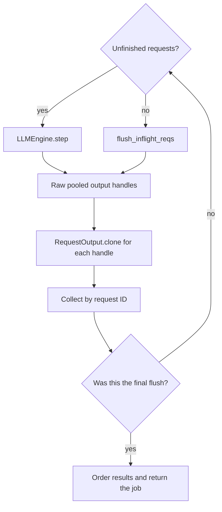

import Source from '../../../../components/Source.astro';

## Treat generation as a job with a return path

`LLM.generate()` accepts a set of prompts, submits persistent request state and
drives the engine until results are collected. Requests can finish in different
iterations; the wrapper returns them in request-ID order rather than exposing
that execution order as the application's result order.

Following this loop connects input preparation, scheduling, overlapping execution
and output ownership without requiring an external serving layer.

## Follow submission and collection



The diagram includes both ordinary steps and the final flush. Both return pooled
native outputs that the wrapper must preserve before advancing or returning.

Input preparation validates prompts and sampling parameters, tokenizes text when
needed, assigns request IDs and creates native sequence state. The engine adds
those sequences to scheduling. Persistent sequences retain request progress,
stopping conditions and model state across many steps.

Each `step()` selects work and coordinates workers. Result processing maps sampled
output back to the corresponding sequence, updates its progress, and constructs
request outputs. The public wrapper accumulates those results while unfinished
work remains.

## Preserve native results before advancing

The worker-to-engine return representation uses `uint64` handles to pooled
`RequestOutput` objects. Those addresses are not owning Python results. The
wrapper uses the actual preservation operation:

```python
output = RequestOutput.clone(raw_output)
```

That clone makes the collected result independent of later pool reuse. A Python
copy of the raw address array would still point to the same pooled objects.

This boundary matters for direct integrations that call the engine below `LLM`.
They must implement the same ownership rule instead of keeping raw handles across
subsequent steps.

## Drain the final in-flight work

With overlapped execution, the scheduler can have no unfinished requests while a
worker still retains a previous result. `_run_engine` therefore calls
`flush_inflight_reqs` after ordinary scheduling ends. It clones that returned
output as well, then orders results and optionally decodes token IDs.

Scheduler emptiness and result drainage are separate conditions. The flush closes
the return path before the job reports completion. Public close then handles the
engine/worker lifecycle.

The major application choices are input representation, sampling/stopping policy
and whether a lower-level integration takes over collection. Cancellation and
constraint errors still need to retire request-owned state, but the high-level
path remains submission → repeated steps → output preservation → final drainage.

## Read the code

<Source project="deepinfer" path="deepinfer/entrypoints/llm.py" label="generate, request preparation and _run_engine" />
<Source project="deepinfer" path="deepinfer/engine/llm_engine.py" label="add_request, step and final flush" />
<Source project="deepinfer" path="csrc/engine/sequence.hpp" label="Persistent request state" />
<Source project="deepinfer" path="csrc/engine/pybind_output.cpp" label="Output handles and clone ownership" />
