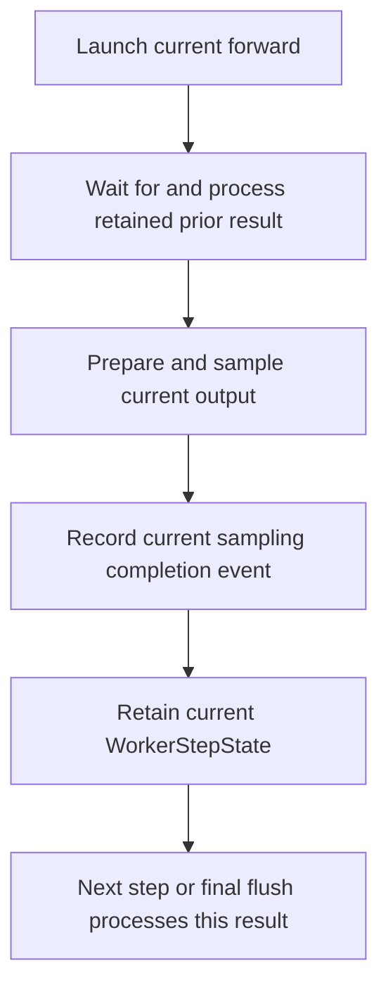

import Source from '../../../../components/Source.astro';

## Overlap execution with the return path

The worker can launch current model work while processing a prior result. This
reduces the gap between device operations, but extends the lifetime of metadata,
sampled tensors and request references across iterations.

DeepInfer calls this zero-overhead scheduling (ZOS). The important mental model
is two live step states, not an assertion that host work costs nothing.

## Follow the selected decode path

The arrows order host-side phases. Forward and sampling calls can enqueue
asynchronous work; their corresponding events and dependencies establish when
result access is complete. Engine synchronization/retirement callbacks participate
in that phase sequence.

Prompt steps and execution with ZOS disabled process current output in place.
The retained-state path above explains the distinctive decode overlap behavior.

## Keep state and request identity together

`WorkerStepState` holds the selected sequence metadata, sampling outputs and
completion event needed for later post-processing. That retained metadata still
connects device rows to native requests after the forward call returns.

Current and prior batches can have different membership or row order. Correction
uses matching request identity and prior accepted results, rather than assuming
row i still belongs to the same request. This supplies the exact lengths and
other metadata required by the selected execution/sampling path.

A plan can therefore describe current reserved work while the host is reconciling
the previous result. Keep planned or tentative progress separate from the
committed sequence frontier.

## Retire results only after the dependency completes

`_post_process_step` waits for the sampling event before reading results and
invoking engine output processing. That callback updates sequence state and
collects resources for deferred release. The event protects the return-path
consumer, while block/state copy dependencies protect their own storage readers.

The final retained result needs `flush_inflight_reqs` after ordinary scheduling
ends. Scheduler emptiness is not the same as a drained output pipeline.

When changing this loop, follow one request through two steps and identify the
owner of current inputs, prior outputs and metadata awaiting release. That reveals
which dependency a proposed optimization must preserve.

## Read the code

<Source project="deepinfer" path="deepinfer/worker/worker.py" label="execute_model_step, _post_process_step and final flush" />
<Source project="deepinfer" path="deepinfer/worker/zos_status.py" label="Retained WorkerStepState and request remapping" />
<Source project="deepinfer" path="deepinfer/engine/llm_engine.py" label="Output reconciliation and deferred retirement" />
