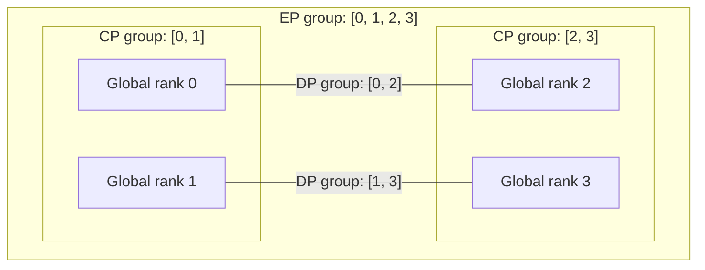

import Source from '../../../../components/Source.astro';

## Name the group before interpreting communication

A rank can belong to several groups because the model partitions different work
in different ways. **Context parallelism (CP)** cooperates over context work;
**data parallelism (DP)** partitions the relevant attention work; **expert
parallelism (EP)** distributes expert computation and routing.

These groups are cooperation scopes inside the model job. A DP participant is
not automatically an independent serving replica that can ignore the other model
communication.

## Read one small membership example

For a teaching job with DP two, CP two and EP four:

CP groups are `[0,1]` and `[2,3]`; DP connects corresponding CP positions as
`[0,2]` and `[1,3]`; EP includes all four ranks. Lines indicate membership, not
physical links or a selected collective algorithm. The real model's hardware and
storage requirements still determine a runnable configuration.

Group construction derives these memberships from the configured rank geometry.
Record both global rank and rank within the relevant group when following a call:
“rank zero” needs a named scope to identify an owner unambiguously.

## Follow control and tensor paths

Workers initialize the distributed environment before model execution. The runtime
constructs groups for the selected geometry, including CPU and device resources.
Control messages and tensor payloads can use corresponding participants through
different backends or objects.

Communication wrappers express the required operation on the selected group.
An all-reduce combines contributions and distributes the result; a gather or
reduce has a different result-ownership contract. Follow that contract into the
caller before assuming every rank owns the same output buffer.

Parallel layout also affects input preparation. CP work can need rank-local token
views and later result reconstruction. EP dispatch routes activations to expert
owners and combines their contributions. Those are different data movements even
when the same rank participates in both.

## Decisions that matter to an architecture trace

**Geometry:** operator-selected group sizes must be compatible with model state and
execution. They determine participation and local storage, not just a number of
processes to launch.

**Operation:** the model chooses the collective or point-to-point behavior it
needs. Group membership identifies participants; operation semantics identify
where useful results become available.

**Mechanism:** the selected communication implementation maps that operation onto
devices and networking. Local collectives and inter-host transfers can take
different paths. The ecosystem map alone does not choose a network plugin.

Start with the group and operation at the model call site, then inspect the
backend when the transport itself is the question.

## Read the code

<Source project="deepinfer" path="deepinfer/model_executor/parallel_utils/parallel_state.py" label="Group geometry and rank translation" />
<Source project="deepinfer" path="deepinfer/worker/base.py" label="Worker distributed initialization" />
<Source project="deepinfer" path="deepinfer/model_executor/parallel_utils/communication_op.py" label="Communication operations and result roles" />
<Source project="deepinfer" path="deepinfer/model_executor/parallel_utils/userbuffer.py" label="Selected device communication buffers" />
