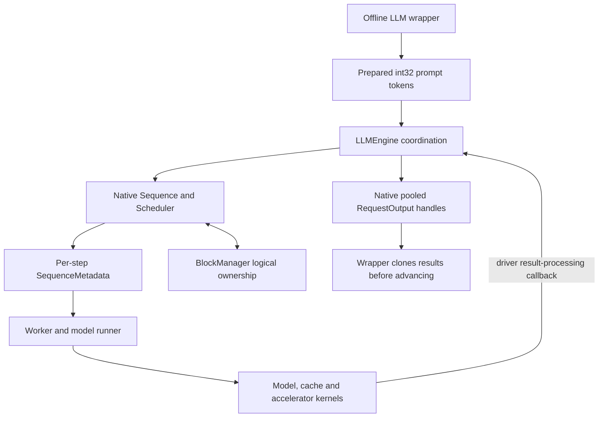

import Source from '../../../../components/Source.astro';

## Start at the offline request boundary

DeepInfer's public wrapper accepts a batch of prompts and drives the engine until
results are ready. Follow that operation before exploring optimized model code:
it explains why scheduling, cache ownership, workers and output processing exist.

The released engine has a defined model/hardware scope. Its repository contains
both Python orchestration and native C++ request state; the boundary between them
is a useful organizing principle for a new developer.

## Map representations to owners

The arrows connect representations used by different owners. Prepared tokens,
persistent sequences, one iteration's metadata and returned outputs serve different
lifetimes even when they describe the same logical request.

| Area | Responsibility |
| --- | --- |
| `entrypoints/llm.py` | Normalize input, drive the offline loop and preserve results. |
| `engine/llm_engine.py` | Coordinate requests, workers, cache actions and result reconciliation. |
| `csrc/engine` | Own sequences, scheduling queues, block references and native outputs. |
| `worker` | Prepare a step, execute it, and retain results needed by later processing. |
| `model_executor` | Construct the model, prepare tensors and run attention/expert/sampling code. |

Start with the owner of the behavior you want to change. A token-admission question
belongs to scheduling; a wrong tensor layout belongs to worker input preparation;
a result that changes after another step points to the output ownership boundary.

## Follow one iteration through the repository

`LLM.generate()` adds requests and calls engine `step()`. Native scheduling returns
sequence metadata and allocation actions. The engine coordinates state copies and
worker execution; workers build inputs, run the model and sample. Result processing
then updates native sequence progress and creates request outputs.

Under overlap, part of that return path belongs to the preceding step. Keeping
iteration and request identity attached to retained metadata explains which owner
can safely update or release it.

The Python/native boundary deserves one concrete detail: returned `uint64` values
are addresses of pooled `RequestOutput` objects. Copying the address array does not
copy those objects. The public wrapper calls `RequestOutput.clone(raw_handle)` to
retain an owning result before another step can release pooled storage.

## Choose a focused source route

For a first trace, read wrapper → engine step → scheduler → worker → output
collection. Then branch into one subsystem instead of reading every backend:

- Admission or stopping: native `Scheduler` and `Sequence`.
- Capacity or reuse: `BlockManager` and engine deferred release.
- Model computation: the selected model builder and worker model runner.
- Distributed work: process groups and communication operations.

External serving and shared-cache infrastructure remain outside this offline job
boundary. Treat workspace projects as neighboring capabilities, then inspect the
actual build/integration before assuming a particular combination is supported.

## Read the code

<Source project="deepinfer" path="deepinfer/entrypoints/llm.py" label="LLM wrapper" />
<Source project="deepinfer" path="deepinfer/engine/llm_engine.py" label="Engine coordination" />
<Source project="deepinfer" path="csrc/engine/scheduler.hpp" label="Scheduler and step metadata" />
<Source project="deepinfer" path="csrc/engine/pybind_output.cpp" label="Raw output handles and owning clone" />
