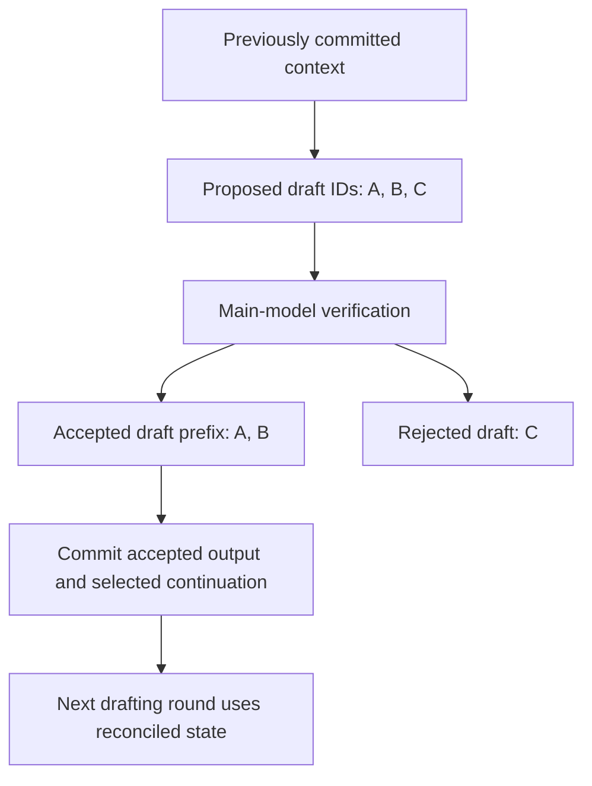

import Source from '../../../../components/Source.astro';

## Convert model work into accepted output

Sampling selects token IDs from model scores under a request's generation policy.
Speculative execution adds draft proposals that the main model must verify.
Those proposals can reduce useful latency, but only accepted results advance the
committed request state.

This chapter follows the boundary between computed scores, candidate IDs and
output processing rather than cataloging sampler variants.

## Trace the selected rows and request policy

User sampling parameters become native request state and per-step sampling input.
The model runner prepares the selected rows, lengths and metadata needed by the
sampler. Under padding, context-parallel layouts or overlap, a physical output row
must still be associated with the intended request and token position.

Sampling then applies the selected policy, such as greedy or randomized selection,
and any active constraints. Parameters control that choice; model/step metadata
controls which scores the policy is choosing among.

## Keep proposals separate from committed state

In this teaching example, proposals A/B/C yield an accepted draft prefix A/B.
The selected algorithm supplies the continuation, and native output processing
commits the corresponding result. Tentative physical writes from speculative work
do not, by themselves, establish accepted request or matcher progress.

The engine tracks proposal and acceptance quantities separately. Rejected work
can consume compute and temporary state without becoming useful output. Later
steps must use the reconciled frontier rather than treating every scheduled draft
position as committed context.

This is also why counting launched token positions alone is insufficient when
comparing speculative execution with ordinary decode. Useful accepted output is
the result that should be related to work and latency.

## Decisions that change the path

| Choice | Main consequence |
| --- | --- |
| Sampling/stopping policy | Determines token selection and when the request finishes. |
| Drafting and verification strategy | Trades extra candidate work against accepted progress per step. |
| Overlapped execution | Carries result identity and corrected metadata across iterations. |
| Structured constraints | Restricts allowed choices and maintains request-owned matcher state. |

Runtime estimates can help select verification work. Those decisions still feed
the same acceptance and reconciliation boundary; a performance estimate does not
make a proposal valid output.

For a first source trace, start with ordinary sampling, then add one verification
round. Follow the sampler result into native sequence updates and the output
objects collected by the wrapper. That return path explains what the application
actually receives.

## Read the code

<Source project="deepinfer" path="deepinfer/sampling_params.py" label="User generation policy" />
<Source project="deepinfer" path="deepinfer/model_executor/sampling_inputs.py" label="Per-step sampling and acceptance metadata" />
<Source project="deepinfer" path="deepinfer/worker/model_runner.py" label="Model execution and sampling preparation" />
<Source project="deepinfer" path="csrc/engine/process_output.hpp" label="Accepted output and persistent sequence updates" />
