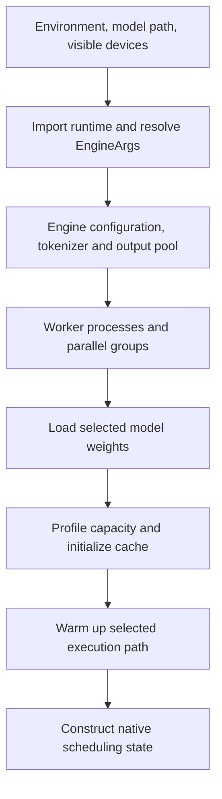

import Source from '../../../../components/Source.astro';

## Build a runnable execution context

Startup turns an offline job configuration into workers, loaded parameters,
allocated cache and native scheduling state. Its main dependency is simple:
scheduling must use capacities and layouts that match the initialized model and
devices.

The examples establish environment and model artifacts before importing the
runtime. This matters because runtime imports and initialization can read process
configuration and choose platform-specific behavior.

## Follow the initialization chain

The chain shows the main dependency order. Loaded weights determine memory use;
profiling and cache initialization resolve available capacity; the native
scheduler receives those resolved resources.

The public `LLM` builds engine arguments for offline inference. `LLMEngine` creates
tokenizer/output ownership, starts workers and establishes parallel groups.
Workers construct and load the selected model before cache capacity is profiled
and initialized. Warmup prepares the selected execution path, and native sequence
scheduling is constructed against the resulting limits.

A worker is a process participating in the distributed model job. Process rank,
visible device and group membership must agree before useful communication and
model execution can begin.

## Understand the configuration boundaries

| Configuration | What it controls |
| --- | --- |
| Model/artifact location | Architecture and checkpoint contents to load. |
| World and group sizes | Which ranks cooperate on context, attention and experts. |
| Context, sequence and memory budgets | Cache capacity and how much work can be admitted. |
| Execution mode and acceleration features | The selected scheduling/execution strategy and its dependencies. |

These are operator or integration choices. Runtime scheduling later decides which
requests use the configured capacity; it does not change an incompatible process
layout into a valid one.

Capacity planning has two distinct stages. Startup allocates physical storage and
resolves limits. Iteration scheduling admits logical work within that storage.
An initialized cache can still be temporarily full while requests are active.

## Trace failures by the dependency that failed

When startup fails, locate the last established stage: artifacts/configuration,
process groups, model load, cache setup or warmup. A model-loading failure and an
iteration admission delay belong to different owners.

The engine coordinates worker callbacks and native state, so teardown must follow
its lifecycle. Close the public engine when the job finishes rather than treating
worker processes and registrations as incidental Python objects.

For a first integration, use the released example's supported model/platform
configuration. Add an optional feature after the ordinary startup and one request
work; its constructor path then has a clear place in the chain.

## Read the code

<Source project="deepinfer" path="examples/_config.py" label="Example environment and job layout" />
<Source project="deepinfer" path="deepinfer/engine/arg_utils.py" label="Engine argument/configuration boundary" />
<Source project="deepinfer" path="deepinfer/engine/llm_engine.py" label="Construction, workers and cache initialization" />
<Source project="deepinfer" path="deepinfer/model_executor/parallel_utils/parallel_state.py" label="Parallel group initialization" />
