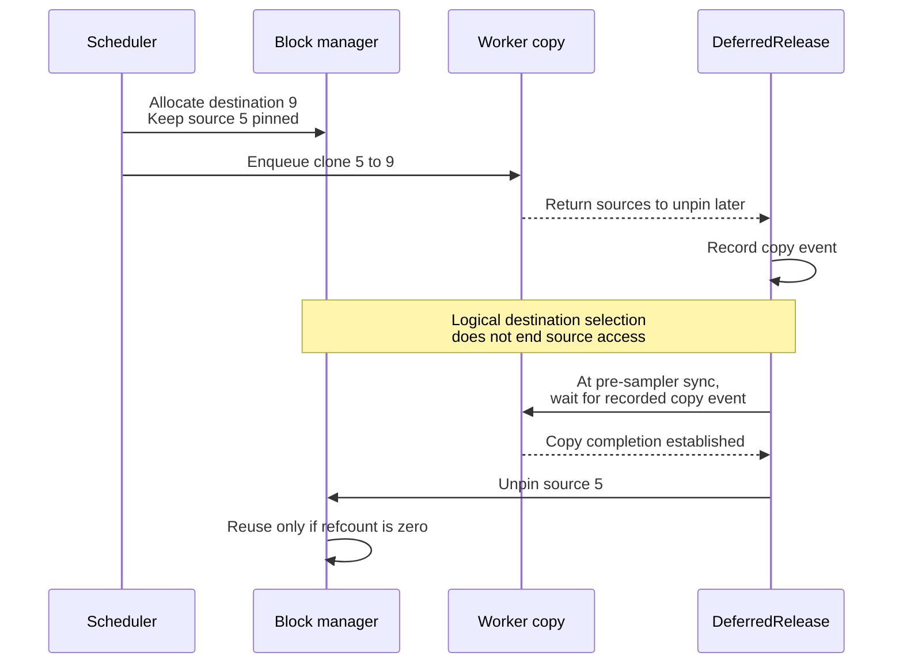
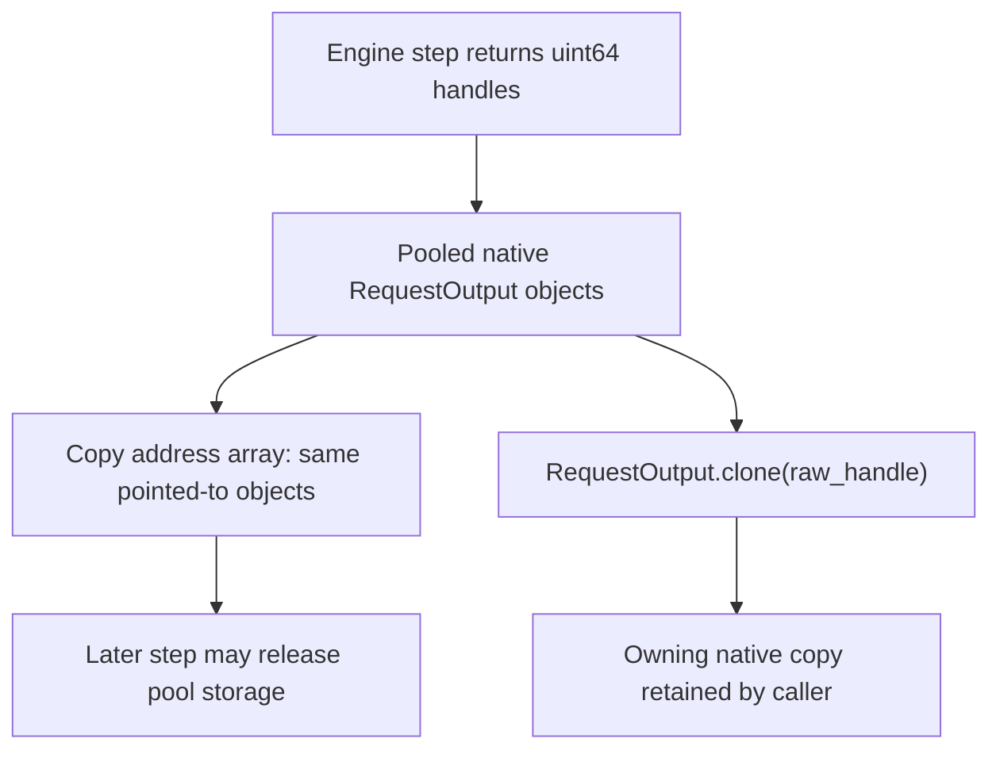

import Source from '../../../../components/Source.astro';

## Track logical ownership through asynchronous work

DeepInfer manages cache and model state with native block references while workers
operate on physical accelerator storage. Logical allocation identifies where a
request's state belongs; device completion determines when an old reader or copy
has stopped using it.

The scheduler owns admission and references. The worker cache engine performs
state operations. `LLMEngine` joins their lifetimes through deferred retirement.

## Follow one state clone

Slots 5 and 9 are a teaching example. Selecting the destination does not release
the source: the queued copy still needs its contents. The engine records a copy
event, keeps the source pinned, and unpins it only after that event establishes
completion. Other live references can still prevent reuse.

`BlockManager` accounts for logical capacity, including references needed by
active sequences and state operations. The worker's cache engine implements
copying and zeroing against the physical layout. Keeping those owners separate
explains why an allocation decision alone cannot certify safe storage reuse.

`DeferredRelease` collects metadata, pooled outputs and clone-source references
that outlive their immediate call. At the engine's retirement point it releases
the appropriate resources, synchronizing recorded clone work before unpinning
its sources.

## Returned output has another pool lifetime

The same ownership principle applies at the Python/native interface. Engine
steps return addresses of pooled `RequestOutput` objects. An array of addresses
can remain readable after the pointed-to objects become invalid or reused.
`RequestOutput.clone(raw_handle)` creates the owning copy retained by the public
wrapper.

There are therefore two useful questions: who owns the backing object, and which
outstanding work still references it? A Python reference, a numerical block ID
or a completed enqueue call answers only part of the question.

## Decisions that affect capacity and reuse

| Decision | Consequence |
| --- | --- |
| Admit more requests | Requires allocatable logical blocks within initialized physical capacity. |
| Share or clone state | Adds references or copy work that can extend source lifetime. |
| Reuse a slot | Requires all relevant owners and asynchronous readers to retire. |
| Retain an engine result | Requires an owning output clone rather than raw pooled handles. |

Temporary admission pressure differs from a request whose state cannot fit the
configured limits at all. Inspect scheduler decisions and block ownership before
attributing either condition to a new device-allocation failure.

## Read the code

<Source project="deepinfer" path="csrc/engine/block_manager.hpp" label="Logical block ownership and capacity" />
<Source project="deepinfer" path="deepinfer/worker/cache_engine.py" label="Physical state copying and zeroing" />
<Source project="deepinfer" path="deepinfer/engine/llm_engine.py" label="DeferredRelease and copy-event retirement" />
<Source project="deepinfer" path="csrc/engine/pybind_output.cpp" label="Pooled output handles and owning clone" />
