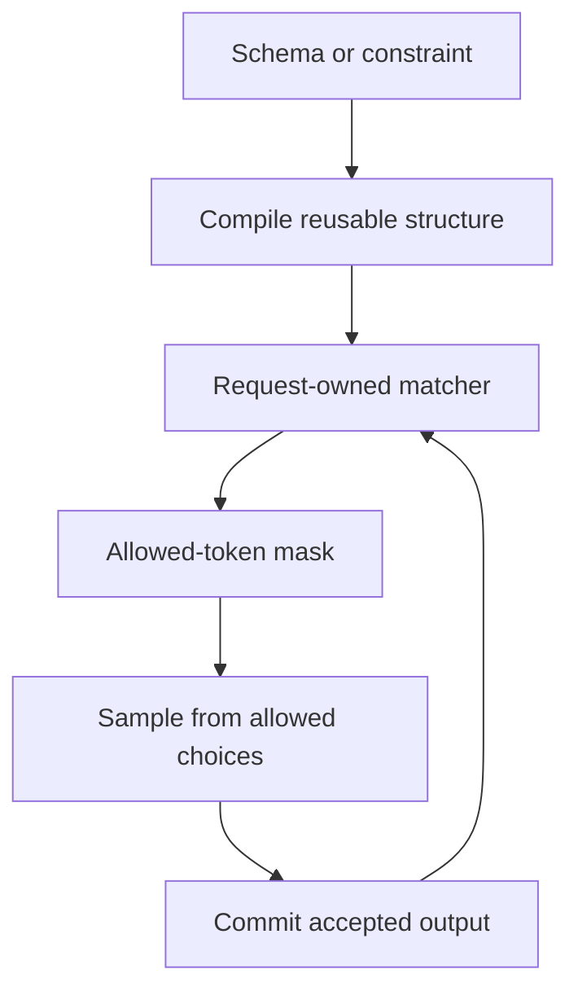

import Source from '../../../../components/Source.astro';

## A schema becomes generation state

Structured generation constrains which next tokens are valid for a schema or
other supported format. It adds a stateful loop around ordinary sampling: compile
the constraint, track each request's progress, restrict token choices, and advance
that state with accepted output.

Compilation can be reusable; a request's matcher state belongs to that request's
particular accepted prefix. Sharing the former does not merge the latter.

## Follow the constraint loop

The loop follows committed generation. A draft proposal can be evaluated without
becoming the matcher's permanent accepted prefix.

## Prepare a matcher before admission

`SOMatcherBuilder` coordinates background preparation with engine-owned admission.
A worker compiles the constraint and constructs the matcher; the engine-side
`pump` observes completed preparation, attaches the result and invokes its ready
callback. Compilation workers do not directly mutate scheduling queues.

Pending preparation counts as unfinished work, so the engine continues pumping
rather than treating a temporarily empty runnable queue as a completed job.
Preparation errors or an abandoned request are resolved before the result is used
for execution.

For resumed constrained work, matcher progress must correspond to the accepted
token prefix. Reusing compiled schema information saves preparation cost; restoring
request-specific progress is a separate responsibility.

## Connect matching to sampling and lifecycle

The matcher supplies allowed choices through a mask used by the selected sampling
path. Output processing advances the request state after acceptance. Keeping those
operations together explains both correctness and ownership: a mask for the wrong
prefix can be internally well formed yet constrain the wrong generation state.

The main developer choices are the supported constraint form, preparation/caching
strategy and how constrained requests participate in the normal execution loop.
Detailed compiler representations and mask kernels can be followed after those
boundaries are clear.

During cancellation or shutdown, pending compilation and request-owned matchers
still need their lifecycle handled. The engine owns that coordination rather than
assuming a completed future is always an active request ready to schedule.

## Read the code

<Source project="deepinfer" path="deepinfer/structure_output/so_matcher_builder.py" label="Preparation, pump and admission handoff" />
<Source project="deepinfer" path="deepinfer/structure_output/compiler.py" label="Reusable compiled constraints" />
<Source project="deepinfer" path="deepinfer/structure_output/matcher.py" label="Request-owned progress" />
<Source project="deepinfer" path="deepinfer/structure_output/mask.py" label="Allowed-token masks" />
