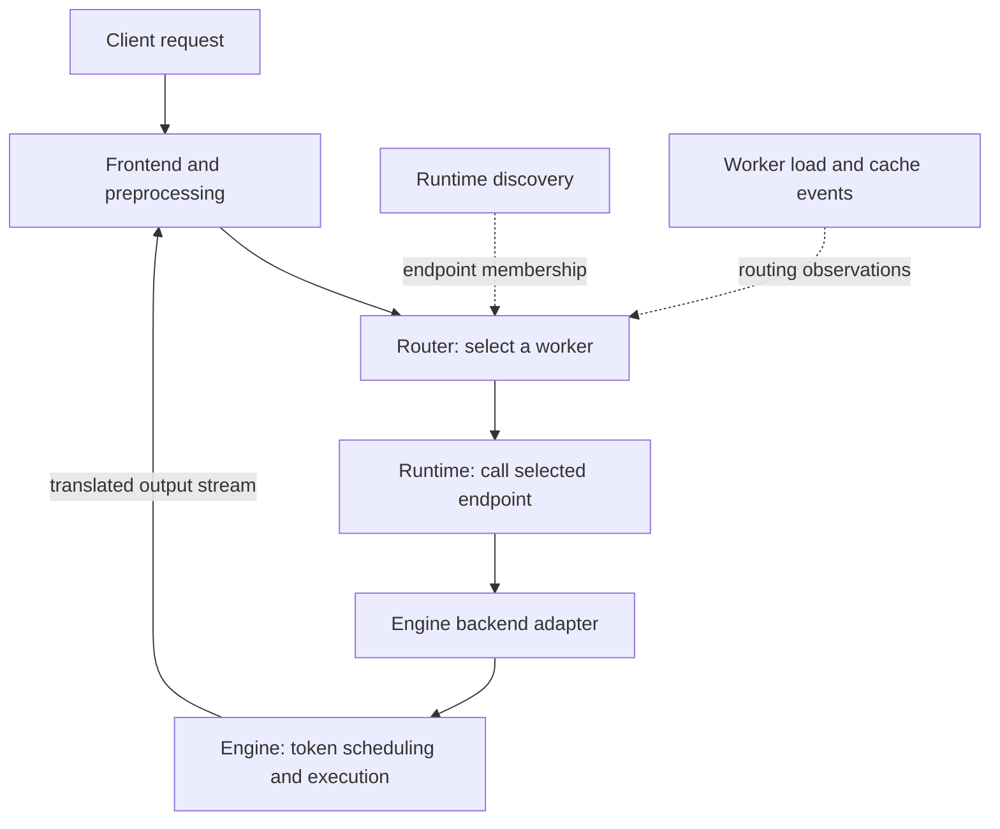

import SystemMap from '../../../components/SystemMap.astro';
import Source from '../../../components/Source.astro';

## Why it exists

Adding model replicas turns a local inference problem into a serving problem: which worker should receive a request, how should reusable attention state influence that choice, and when should capacity change? Dynamo supplies the coordination around inference engines so a service can scale while managing first-token latency and streaming throughput.

An **inference engine**, such as vLLM or SGLang, schedules tokens and executes the model. Dynamo accepts requests, discovers workers, routes work, translates engine interfaces, and coordinates separate serving stages. The [project overview](https://github.com/ai-dynamo/dynamo/blob/73014901d4e7610358fcf28535418ba9c5f50812/README.md) introduces those responsibilities.

## Where it fits

<SystemMap current="dynamo" />

The frontend is the client-facing service; backend adapters connect it to engine workers. In aggregated serving, one worker handles prompt processing and generation. In disaggregated serving, prefill workers compute prompt state and decode workers continue generation. A configured engine connector can use NIXL to move the KV tensors between them.

**KV cache** is the attention state retained from earlier tokens. Dynamo's routing index describes where useful state may exist. The engine and its connectors own the actual storage and access to those bytes.

## Architecture overview

Follow the main request path and the metadata that supports worker selection:

The frontend, router, runtime, adapter, and engine each own a different part of the operation. Discovery provides membership; cache and load events inform placement; the engine makes the final token-scheduling decisions.

## Follow an operation

A typical text request takes this route:

1. The frontend validates the public request and preprocesses it into model tokens and generation options.
2. The router selects a compatible worker using the configured policy, load, and cache information. A booking can account for work before fresh engine metrics arrive.
3. The runtime reaches that worker's endpoint. Its backend adapter translates Dynamo's request into the engine API.
4. The engine schedules the model work. A disaggregated path first obtains prompt state from the prefill stage through its configured connector.
5. Engine outputs return through the adapter and frontend transformations to the client. Request completion also retires routing and engine resources through their owners.

Start with the [aggregated launch example](https://github.com/ai-dynamo/dynamo/blob/73014901d4e7610358fcf28535418ba9c5f50812/examples/backends/vllm/launch/agg.sh) before following the [prefill/decode walkthrough](/walkthroughs/prefill-decode/).

## Decision gates

| Decision | Main tradeoff | Owner |
| --- | --- | --- |
| Aggregated or separate prefill/decode pools? | Simpler lifecycle versus independent scaling and transfer cost | Operator |
| Which eligible worker? | Cache reuse versus queue/load balance | Router under configured policy |
| Which engine and connector? | Model/runtime capabilities and state-transfer integration | Developer/operator |
| How much capacity? | Latency/throughput targets versus infrastructure cost | Planner and deployment controller |

## Explore the code

Read [startup](/architecture/dynamo/startup/), [the frontend path](/architecture/dynamo/frontend-path/), and [worker selection](/architecture/dynamo/routing-selection/) to trace one request. Continue into [adapters](/architecture/dynamo/backend-adapters/) and [prefill/decode](/architecture/dynamo/prefill-decode/) when the request reaches engine-specific work.

<Source project="dynamo" path="lib/llm/src/entrypoint/input/common.rs" label="Frontend pipeline assembly" />
<Source project="dynamo" path="lib/kv-router/src/services/selection/core/run.rs" label="Worker selection execution" />
<Source project="dynamo" path="components/src/dynamo/vllm/handlers.py" label="vLLM request handlers" />
