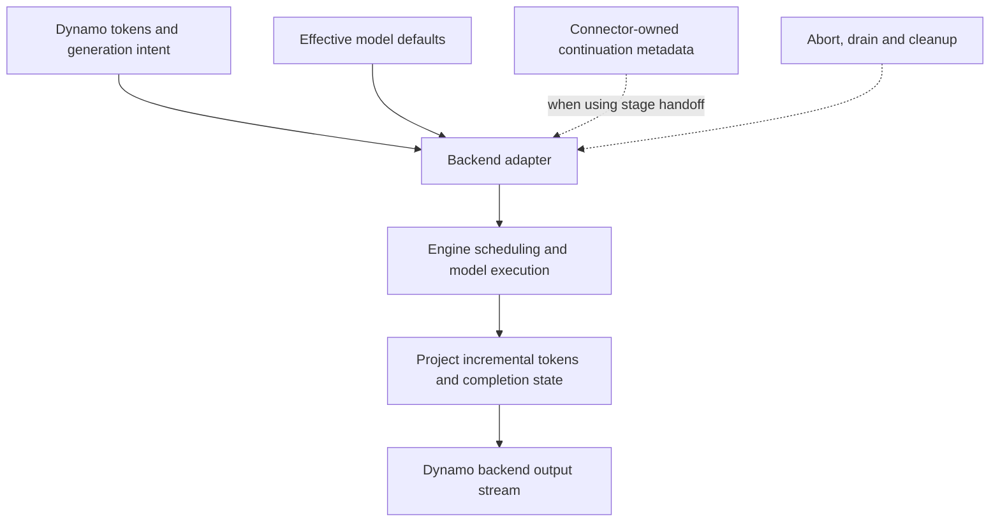

import Source from '../../../../components/Source.astro';

## Translate serving intent into an engine contract

Dynamo's backend adapter connects distributed serving to a particular inference engine. It starts the engine, publishes its capabilities, translates requests, projects outputs, and implements engine lifecycle operations. The model scheduler and kernels remain inside the engine.

This chapter follows the vLLM adapter. The same architectural boundary exists for other backends, but each owns its engine-specific request and continuation formats.

## The translation path

The adapter translates across one engine boundary. Final public text/protocol assembly continues in the frontend's backward pipeline.

<Source project="dynamo" path="components/src/dynamo/vllm/main.py" label="vLLM engine construction and publication" />
<Source project="dynamo" path="components/src/dynamo/vllm/handlers.py" label="Request translation and output handlers" />

## Inputs: defaults, tokens, and continuation

Preprocessing has already produced prompt tokens and normalized request options. The adapter builds the engine's prompt and sampling objects, preserving the caller's supported choices and the model's effective defaults. In the ordinary text path, model generation defaults are applied before request overrides.

Engine-specific rank, priority, and tracing arguments are translated here as well. This is the source boundary to inspect when a public option reaches the worker but has a different effective value at the engine call.

A disaggregated request also carries continuation metadata. The adapter delegates its interpretation to the selected connector strategy. NIXL pull coordination, push-based coordination, and shared-cache-mediated reuse can require different handoff information. The generic frontend carries that information while the owning strategy explains its meaning.

<Source project="dynamo" path="components/src/dynamo/vllm/kv_connector_protocols.py" label="Connector-specific prefill/decode strategies" />

## Outputs and lifecycle

An engine result can include generated tokens, finish state, usage, and handoff information. Output projection must preserve increments correctly when the engine's representation is cumulative. A metadata-only result can still be important even when it adds no visible token.

After the adapter yields Dynamo output, the frontend applies the remaining text and response-protocol transformations. This separates model execution, engine-result translation, and public response construction into traceable owners.

The adapter also bridges cancellation and service health. It translates abort into the engine's safe operation, drains outstanding work as required, and releases initialized resources on cleanup. Engine death is a worker-level failure; invalid request input belongs to the request boundary. Those categories guide failure handling without turning the architecture guide into an exception catalog.

## Decisions and reading order

| Decision | Owner and consequence |
| --- | --- |
| Which engine? | Deployment selects the model/runtime capabilities and adapter |
| What effective generation options? | Adapter applies the selected defaults policy and request overrides |
| How does prefill state reach decode? | Configured connector strategy supplies the handoff contract |

Read backend startup, the handler's input construction, the engine call, output projection, then lifecycle handling. The <Source project="dynamo" path="components/src/dynamo/common/backend/README.md" label="Common backend lifecycle" /> names the shared responsibilities. Follow the [vLLM architecture guide](/architecture/vllm/) once the trace reaches engine scheduling, or [stage handoff](/architecture/dynamo/prefill-decode/) for distributed prompt state.
