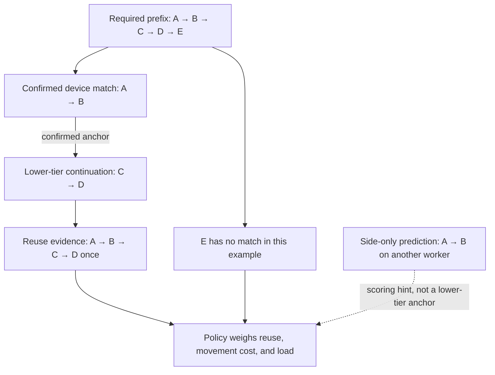

import Source from '../../../../components/Source.astro';

## Reuse changes the cost of a prompt

Two workers can host the same model while retaining different attention state. A compatible cached prefix can save prompt computation. Routing must weigh that saving against load and any cost to move state into the engine's usable cache.

Dynamo therefore maintains a view of reusable prefixes and combines it with placement policy. The router owns the index and its estimates. The engine and connector own the KV allocations and movement that make the selected state usable.

## From engine events to routing evidence

Engine cache events describe stored and removed blocks. The listener normalizes those events and applies them to the routing index. Prefix identity includes token ancestry: state for a later block is reusable only with its compatible preceding context.

Three kinds of evidence matter at this level:

| Evidence | Meaning for placement |
| --- | --- |
| Confirmed device residency | Reuse already reported by engine cache events |
| Lower-tier availability | Additional state may be reusable after movement |
| Predicted reuse | Recently routed work can inform cost before confirming events arrive |

Prediction and confirmation have different confidence. Event delivery also evolves over time, so placement uses a current view that the engine must turn into valid execution.

<Source project="dynamo" path="lib/kv-router/src/protocols.rs" label="Cache event and prefix identity protocols" />
<Source project="dynamo" path="lib/kv-router/src/services/indexer/listener.rs" label="Cache event ingestion" />

## One lookup example

A request needs blocks A→B→C→D→E. A worker has A→B confirmed on device, with C→D available in a lower tier. Lookup can extend the confirmed prefix with that continuation:

The combined evidence covers A through D once. E still needs computation. Moving lower-tier blocks has a cost, so four matched blocks do not necessarily provide the same benefit as four device-resident blocks. A predicted side-only prefix can influence scoring without becoming a confirmed anchor for lower-tier continuation.

This is the useful invariant behind the implementation: preserve the distinction between where state is known to reside and how much work its reuse might save.

<Source project="dynamo" path="lib/kv-router/src/services/indexer/lookup.rs" label="Prefix lookup pipeline" />

## From lookup to a placement decision

Lookup supplies evidence; policy turns it into a comparison across eligible workers. The longest visible match is one input. Weighted reuse credit, state movement, and current load affect the remaining work estimate.

Active-block tracking answers another question: which prompt blocks are associated with routed requests that are still live? That supports load/accounting decisions. The active view and cache-residency view can both describe a block while owning different parts of its lifecycle.

A useful diagnosis starts with the decision inputs. For an unexpected worker choice, compare eligible membership, cache evidence, and load. For an unexpected miss, inspect compatible token lineage and the event-to-index path. Continue into the engine when the question concerns whether chosen state was actually allocated, transferred, or consumed.

## Decisions and source route

The consequential choice is the reuse/load balance used by placement policy. Supporting choices determine which cache observations and tiers participate in that estimate. Neither choice requires exposing every tree backend or event recovery option in the main architecture trace.

Read the cache protocols, event listener, lookup pipeline, then <Source project="dynamo" path="lib/kv-router/src/sequences/block_tracker.rs" label="Active request-block tracking" />. The <Source project="dynamo" path="lib/kv-router/src/services/selection/README.md" label="Selection and indexing invariants" /> connects those structures to worker selection. Use [routing selection](/architecture/dynamo/routing-selection/) for the booking that follows a placement decision.
