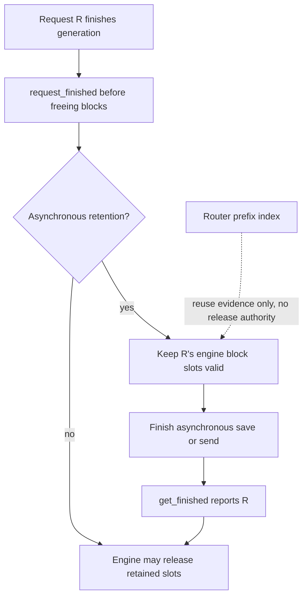

import Source from '../../../../components/Source.astro';

## Place KVBM beside the engine and router

Dynamo's optional **KV block manager**, KVBM, integrates with an engine to manage cache-block lifecycle and movement. It complements two existing owners: the engine allocates/schedules its usable KV state, and the router indexes reusable prefixes for placement.

Those owners need compatible identities and lifetimes. A logical prefix, an engine-local block slot, and a managed copy in another tier can refer to related content while having different storage ownership.

KVBM is activated through its selected engine connector, such as `DynamoConnector` in the vLLM integration. Ordinary aggregated or NIXL-only serving does not require this separate subsystem.

<Source project="dynamo" path="components/src/dynamo/vllm/args.py" label="KVBM connector detection" />
<Source project="dynamo" path="components/src/dynamo/vllm/main.py" label="Conditional KVBM setup" />

## The integration has two halves

The connector facade creates a scheduler-side leader and an execution-side worker. The leader handles external matches, engine allocation updates, per-step metadata, and request completion. The worker registers actual cache tensors, binds the step metadata, and performs delegated layer-save/transfer work.

Per-step metadata connects logical scheduling choices to execution-side tensor access. Registration supplies the tensor layout and synchronization objects that native operations need. These are the boundaries to follow before opening the native block implementation.

<Source project="dynamo" path="lib/bindings/kvbm/python/kvbm/vllm_integration/connector/dynamo_connector.py" label="DynamoConnector facade" />
<Source project="dynamo" path="lib/bindings/kvbm/python/kvbm/vllm_integration/connector_leader.py" label="Scheduler-side connector leader" />
<Source project="dynamo" path="lib/bindings/kvbm/python/kvbm/vllm_integration/connector_worker.py" label="Execution-side connector worker" />

## Storage can outlive token generation

When generation ends, `request_finished` can tell the engine to retain blocks for asynchronous saving or sending. `get_finished` later identifies requests whose retained state is safe to release. A final token or router cache hit cannot replace that completion feedback.

Consider request R finishing while its KV is being saved. The client can receive the complete answer while R's block slots remain retained. Reusing those slots before the save finishes could make the transfer read another request's bytes. This is the central storage-lifetime invariant a developer needs from this subsystem.

The native block model supports it with explicit ownership states. Mutable blocks become completed content before they are registered as reusable immutable blocks. Guards and pool ownership control their return to storage. Follow those types when modifying block lifecycle; the detailed enum transitions are downstream of the scheduler/worker contract above.

<Source project="dynamo" path="lib/kvbm-logical/src/blocks/mod.rs" label="Native logical-block ownership" />

## Consequential decisions

| Decision | Why it matters |
| --- | --- |
| Enable KVBM? | Adds managed block/tier lifecycle through an engine integration |
| Which layouts and tiers participate? | Determines storage mapping and movement work |
| When may an engine slot be reused? | Depends on completed execution/transfer uses and connector feedback |

The router's placement index can learn about available state independently of these release decisions. Keep lookup evidence and storage ownership separate when connecting the subsystems.

## Read the code

Start with activation, then the connector facade, leader, worker, and logical-block types. Trace one scheduler metadata record into its execution callback and completion feedback before studying pool internals. The [vLLM KV chapter](/architecture/vllm/kv-memory/) supplies the engine-side cache background; [prefill/decode](/architecture/dynamo/prefill-decode/) explains a distinct stage-transfer use case.
