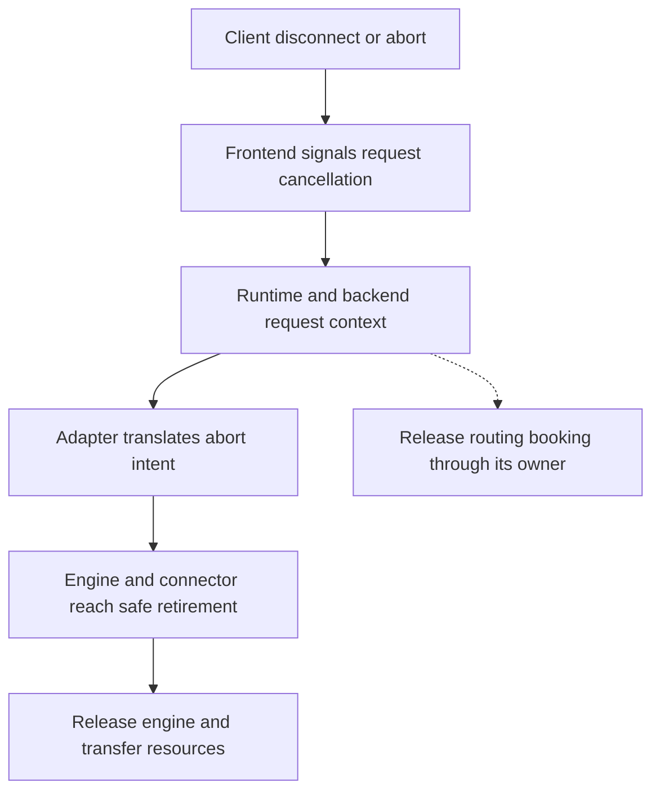

import Source from '../../../../components/Source.astro';

## Stop delivery and retire resources through their owners

A client can stop waiting while remote model or transfer work is still active. Dynamo therefore propagates cancellation through request context and lets each owner retire its work safely. The main trace crosses the HTTP frontend, runtime request, backend adapter, and engine.

This distinction matters most in disaggregated serving, where KV transfers can still reference allocations after the user stream ends. The service owes both prompt cancellation behavior and correct storage cleanup.

## Follow cancellation across the request

The arrows show propagation and responsibility, not a promise that every resource disappears at the moment of disconnect. The engine/connector boundary determines when referenced storage can be reused.

## Connection lifetime becomes request context

The HTTP handler monitors the client connection while obtaining a response. The response stream then retains the monitoring responsibility needed after the handler returns. Disconnection signals cancellation into the request path, allowing later components to stop useful work and clean up.

A request can fail before or after the HTTP response is committed. Before commitment, the frontend can return an HTTP error. After commitment, it uses the stream protocol's failure behavior. In either case, the request context links the client-facing lifecycle to the remote operation.

<Source project="dynamo" path="lib/llm/src/http/service/disconnect.rs" label="Connection monitoring and request guards" />
<Source project="dynamo" path="lib/llm/src/http/service/openai.rs" label="HTTP request and stream lifetime" />

## The adapter owns engine-safe abort

A runtime cancellation signal reaches an adapter that understands the selected engine's abort, drain, and cleanup operations. Resource ownership continues there even after output delivery stops.

The selected vLLM disaggregated decode path illustrates why that translation matters. Its `_DeferredAbort` guard waits for first engine output before performing an abort that could otherwise interrupt an unsafe NIXL transfer window. The adapter retains the deferred task and owns its cleanup when generation fails. This safeguard belongs to that integration rather than every possible engine/connector combination.

Remote prefill can also leave staged KV whose cleanup needs the selected decode worker. Cancellation must preserve that release responsibility while suppressing unnecessary user output. The [stage-handoff chapter](/architecture/dynamo/prefill-decode/) shows the relevant storage owners.

<Source project="dynamo" path="components/src/dynamo/vllm/handlers.py" label="Engine abort guard and generation error handling" />

## Distinguish the failure's scope

| Failure scope | Architectural response |
| --- | --- |
| Invalid public request | Reject at the appropriate request boundary |
| Cancelled request | Stop delivery and retire its booking, engine work, and transfers |
| Dead engine or worker | Escalate through worker/service lifecycle and update availability |

A retry belongs to service policy after identifying which work may already have happened. Discovery and routing can find available workers, while the adapter and engine explain the status of the original execution.

## Read the code

Start with connection guards, follow the cancellation context through the HTTP handler, then enter the selected adapter's abort and cleanup paths. Track the routing booking and engine allocations as separate owned resources. That ownership trace is more useful initially than enumerating every exception and cancellation race.
